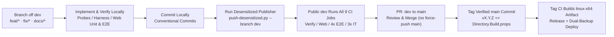

# Engineering Standards & Architecture Decision Records (ADR Index)

English | [简体中文](engineering-standards-and-adr.md)

This document summarizes Bot Agent's repository layout, coding standards & automated architectural ratchets, Git collaboration & release workflow, key technology trade-offs, and all Architecture Decision Records (ADRs). See also [Documentation Hub](../index.en.md) and [Consolidated Open Questions](../open-questions.en.md).

---

## 1. Repository Layout (Matching `BotAgent.slnx`)

```text
.
├── BotAgent.slnx                   # .NET 10 solution (Core/Engine/Platforms/Model/Storage/Mcp/Panel/Headless + 19 contracts + 22 packages + 40 test projects)
├── Directory.Build.props           # Single build baseline & host version source (Nullable/LangVersion/NuGetAudit/Version)
├── Dockerfile.app                  # Artifact-only runtime image for 1 GB hosts (extracts app.tar.gz)
├── docker-compose.yml              # Container orchestration template (qqchat + napcat)
├── start.sh / stop.sh / status.sh  # Native Linux control scripts
├── contracts/                      # 19 host-plugin decoupling contract assemblies (pure DTOs/interfaces)
├── packages/                       # 22 bundled feature & platform packages (C# backends + schemas + sandboxed JS/TS UI)
├── src/
│   ├── BotAgent.Core/              # Domain models, pure state machines, policy/profile resolution (no I/O or network)
│   ├── BotAgent.Engine/            # Chat orchestration, reply pacing, approval use cases, AgentTaskRuntime
│   ├── BotAgent.Platforms/         # OneBot v11, QQ Official, Feishu (WS/Webhook/Crypto) & Local channel (Core-only deps)
│   ├── BotAgent.Model/             # OpenAI / Anthropic / Gemini compatible clients, prompt builders, stream parsers
│   ├── BotAgent.Storage/           # SQLite AppDatabase, WAL migrations, BM25 knowledge store & meta JSON ledgers
│   ├── BotAgent.Mcp/               # Streamable HTTP MCP & isolated Python worker lifecycle
│   ├── BotAgent.Panel/             # ZBA v1 contracts, PanelRoutes, OpenAPI generator & adapters (Core-only deps)
│   ├── BotAgent.Headless/          # Headless host, partial CompositionRoot phases & HTTP runtime
│   └── web/                        # Standalone Vue 3 + TypeScript + Vite console & sandbox iframe bridge (/web/)
├── tools/
│   ├── BotAgent.PluginBundle/      # Bundled plugin release packager
│   ├── BotAgent.OfficialIdentityMigration/  # QQ Official legacy identity compatibility tool
│   ├── mask-cjk.py                 # CJK log-masking helper for privacy-safe triage
│   └── gencert.sh                  # Self-signed TLS cert generator for local reverse proxies
├── tests/
│   ├── BotAgent.ArchitectureProbe/ # Sub-second dependency, ratchet, version, CI & doc-link gatekeeper
│   ├── BotAgent.IntegrationHarness/# Process-level synthetic scenario runner (S1–S165)
│   └── *Probe/                     # 38 focused white-box probes (Safety/Zba/Mcp/Scheduler/ReviewRemediation, etc.)
└── docs/
    ├── index.md / index.en.md      # Unified documentation hub
    ├── glossary.md                 # Domain glossary & security invariants
    ├── open-questions.md / .en.md  # Consolidated cross-doc open questions
    ├── domain/                     # Core business rules (with .en.md mirror)
    ├── storage/                    # Database design & persistence (with .en.md mirror)
    ├── architecture/               # Module boundaries, resolvers, web design system & plugin SDK
    ├── decisions/                  # ADR 0001–0006 & this index (with .en.md mirror)
    ├── operations/                 # Deployment, CI gates, migrations, recovery & runbook (with .en.md mirror)
    └── baseline/                   # Performance & acceptance baselines
```

---

## 2. Coding Standards & Automated Architectural Ratchets

Repository invariants are enforced on every build/CI run via [`Directory.Build.props`](../../Directory.Build.props) and [`BotAgent.ArchitectureProbe`](../../tests/BotAgent.ArchitectureProbe/Program.cs):

### 2.1 Build & Dependency Baseline (`Directory.Build.props`)

- **Language & Nullability**: `<LangVersion>latest</LangVersion>`, `<Nullable>enable</Nullable>`, `<ImplicitUsings>enable</ImplicitUsings>`, `<Deterministic>true</Deterministic>`.
- **Zero High/Critical NuGet Advisories**: `<NuGetAudit>true</NuGetAudit>`, `<NuGetAuditMode>all</NuGetAuditMode>`, `<NuGetAuditLevel>high</NuGetAuditLevel>`, treating `NU1903` and `NU1904` as build errors.
- **Clean Baseline**: No `Import`, `Compile`, `ProjectReference`, or `Condition` in `Directory.Build.props`. Host version comes solely from its single `<Version>`; only projects explicitly registered in `build/release-projects.json` carry independent versions.

### 2.2 Architecture & Quality Ratchets (`ArchitectureProbe`)

| Gate | Rule Enforced | Reference |
| :--- | :--- | :--- |
| **Directed Acyclic Dependencies** | Strict one-way references (`BotAgent.Panel` and `BotAgent.Platforms` depend only on `Core`); legacy adapters must not re-duplicate SQL/file I/O | [ADR-0001](0001-composition-root-assembly-split.md) |
| **Method-Length Ratchet** | Individual methods under `src/` cannot exceed the baseline ceiling (`<= 198` lines); complex logic must be decomposed cleanly | `BotAgent.ArchitectureProbe` |
| **Large-File Governance** | Files > 1000 lines prohibit cosmetic mechanical splitting; changes require architectural boundary review | [Large File Policy](../architecture/large-file-policy.md) |
| **Doc & Route Parity** | ① Zero broken relative links across tracked/new `.md` files; ② 4 required CN/EN root pairs (`README`, `AGENTS`, `CONTRIBUTING`, `SECURITY`); ③ 100% of `PanelRoutes.cs` + ZBA routes covered in [API Surface Map](../api-surface.md) | [API Surface Map](../api-surface.md) |
| **Reproducible Container Digests** | External base images in Dockerfiles/Compose must pin `@sha256:` digests | [Release Checklist](../operations/release-checklist.md) |
| **Frontend & Sandbox Hygiene** | Vue 3.5 + TypeScript 6 + Vite 8: `npm run typecheck && npm run test:unit` required; memory-only Bearer tokens; sandbox iframes support `origin === "null"` and clean up listeners | [`src/web/README.md`](../../src/web/README.md) |
| **Privacy & Desensitization** | Synthetic-only test fixtures; public sync passes blacklist audit, category regex audit & post-push remote re-clone scan | [`CONTRIBUTING.en.md`](../../CONTRIBUTING.en.md) |

---

## 3. Git Collaboration & Release Workflow

Private development worktrees remain strictly isolated from public GitHub branches (`dev` → `main`). Raw un-sanitized branches are **never** pushed directly.



- **Commit Convention**: Conventional Commits (`feat(scope): ...`, `fix(scope): ...`, `docs(scope): ...`), scoped cleanly to one concern.
- **Refactoring PR Discipline**: Must attach before/after outputs for the same `IntegrationHarness` scenarios and **never modify assertions inside a refactor PR**.
- **9 Required CI Checks**: `Build and synthetic probes`, `Web build and browser tests`, 4 Playwright browser matrix jobs, and 3 `Synthetic integration test` shards must all pass (see [CI Quality Gates](../operations/ci-quality-gates.md) and [Branching & Merge Path](../architecture/branching-and-merge-path.md)).

---

## 4. Key Technology Trade-Offs

| Area | Chosen Technology | Rationale & Trade-Offs |
| :--- | :--- | :--- |
| **Backend Runtime** | .NET 10 Headless Modular Monolith (`BotAgent.Headless`) | Compile-time safety and low-RSS execution suitable for `1 GB` servers without microservice mesh overhead, keeping clean module boundaries via `contracts/` + `src/` |
| **Persistence** | SQLite (WAL) + Schema-v15 Isolated `meta` JSON Ledgers | Zero external DB daemon; single-file `VACUUM INTO` hot backups simplify rollback; hashed `meta` buckets with CAS and size caps let Phase 3–5 evolve without risky table rewrites |
| **Console & Control Plane** | Standalone Vue 3 SPA (`/web/`) + ZBA v1 Bearer API | Decouples frontend releases from host binary; OpenAPI generated directly from `PanelRoutes` ensures single source of truth; unset admin token fails closed with `503` |
| **Plugin & Sandbox Model** | 19 Contracts + 22 Managed Packages + Sandboxed iframes | Contract-driven hot reload/toggle of platform & conversation capabilities; `origin === "null"` sandboxed iframes isolate plugin UIs from host DOM & Bearer tokens |
| **Container Packaging** | Prebuilt `app.tar.gz` + [`Dockerfile.app`](../../Dockerfile.app) | Eliminates `dotnet publish` swap exhaustion on `1 GB` production hosts by keeping build workloads on dev/CI machines |

---

## 5. Architecture Decision Records (ADR Index)

| ID | Title | Core Decision & Protected Invariant | Reference |
| :-: | :--- | :--- | :--- |
| **0001** | Composition Root Assembly Split | Splits assembly wiring into partial domain files across 7 explicit bootstrap stages; forbids cyclic cross-module dependencies | [ADR-0001](0001-composition-root-assembly-split.md) |
| **0002** | Unified Agent Task Runtime | Centralizes all `//` & background tasks into an explicit 9-state machine; ZBA/Panel act as channel adapters only | [ADR-0002](0002-agent-task-runtime.md) |
| **0003** | Agent Task Persistence Boundaries | Persists only structural metrics and `boot_seq` in `agent_tasks`; restarts mark interrupted tasks `Unknown` instead of auto-replaying | [ADR-0003](0003-agent-task-persistence.md) |
| **0004** | Unified Memory Authorization | Replaces uncontrolled legacy profiles with revocable, destination-bound per-fact authorization verified at execution time | [ADR-0004](0004-unified-memory-authorization.md) |
| **0005** | Memory Sensitivity × Tool Egress Matrix | Coexists tiered memory and tools via fail-closed `MemorySensitivityTier` × `ToolEgressClass` gating (L2 denies external read egress) | [ADR-0005](0005-memory-tool-coexistence-taint-tiers.md) |
| **0006** | Optional Cross-Platform Identity Linking | Disabled by default; DM-only 120s HMAC mutual verification; strictly bans group KB, chat history, or RBAC privilege sharing | [ADR-0006](0006-optional-cross-platform-identity-linking.md) |
| **Open Design** | Large-File Boundaries Log | Tracks review rules and anti-mechanical-splitting guidelines for files > 1000 lines | [large-file-boundaries-needs-design.md](large-file-boundaries-needs-design.md) |

### Adding a New ADR

1. Before merging cross-module dataflow, state-machine, storage-format, or security-model changes into `main`, add `docs/decisions/000N-<slug>.md`.
2. Include **Status & Components**, **Context**, **Decision & Invariants**, **Protected Semantics (and Probes/Scenarios)**, and **Explicit Non-Goals**, and update this index table.
