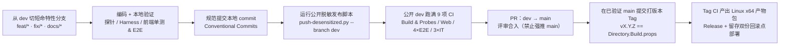

# 工程规范与架构决策记录（ADR）索引

本文整理 Bot Agent 仓库的工程结构、编码规范与自动化门禁、Git 协作/发版流程、核心技术选型依据，以及全部架构决策记录（ADR）总览。

---

## 1. 代码仓目录结构总览（对应 `BotAgent.slnx`）

```text
.
├── BotAgent.slnx                   # .NET 10 解决方案（Core/Engine/Platforms/Model/Storage/Mcp/Panel/Headless + 19 契约 + 22 包 + 40 测试工程）
├── Directory.Build.props           # 全仓唯一构建基线与宿主版本真源（Nullable/LangVersion/NuGetAudit/Version）
├── Dockerfile.app                  # 面向 1 GB 低内存主机的纯产物运行时镜像（解压 app.tar.gz）
├── docker-compose.yml              # 全容器编排模板（qqchat + napcat）
├── start.sh / stop.sh / status.sh  # Linux 原生运维控制脚本
├── contracts/                      # 19 个插件与宿主解耦契约工程（纯 DTO/接口，无重度依赖）
├── packages/                       # 22 个内置功能/平台驱动扩展包（后端 C# + 插件 Schema + 沙箱前端 JS/TS）
├── src/
│   ├── BotAgent.Core/              # 领域模型、纯状态机、策略/Profile 解析、契约与纯规则验证（不碰持久化/网络）
│   ├── BotAgent.Engine/            # 对话编排、回复节奏调度器、审批用例、任务运行时与协调器
│   ├── BotAgent.Platforms/         # OneBot v11、QQ 官方、飞书（WS/Webhook/加解密）与本地演练场驱动（仅依赖 Core）
│   ├── BotAgent.Model/             # OpenAI / Anthropic / Gemini 兼容 LLM 客户端、提示词组装与流式解析
│   ├── BotAgent.Storage/           # SQLite 数据库（AppDatabase）、WAL 迁移、BM25 知识库与隔离 JSON 账本
│   ├── BotAgent.Mcp/               # MCP Streamable HTTP 协议客户端与连接/调用生命周期管理
│   ├── BotAgent.Panel/             # ZBA v1 HTTP 契约模型、路由表、OpenAPI 生成器与适配边界（仅依赖 Core）
│   ├── BotAgent.Headless/          # 无界面运行宿主、CompositionRoot 分域装配、静态独立部署说明
│   └── web/                        # Vue 3 + TypeScript + Vite 管理控制台与沙箱 iframe 桥接（完全静态化部署）
├── tools/
│   ├── BotAgent.PluginBundle/      # 插件产物打包工具
│   ├── BotAgent.OfficialIdentityMigration/  # QQ 官方身份兼容迁移工具
│   ├── mask-cjk.py                 # 排障日志中文遮蔽脱敏脚本
│   └── gencert.sh                  # 本地调试用自签 TLS 证书生成脚本
├── tests/
│   ├── BotAgent.ArchitectureProbe/ # 毫秒级结构/依赖/大文件/版本/CI/文档链接棘轮门禁
│   ├── BotAgent.IntegrationHarness/# 进程级端到端合成测试套件（S1–S165 矩阵）
│   └── *Probe/                     # 38 个专项白盒探针（Safety/Zba/Mcp/Scheduler/ReviewRemediation 等）
└── docs/
    ├── domain/                     # 核心业务规则与领域说明
    ├── storage/                    # 数据库表结构与持久化设计
    ├── architecture/               # 模块边界、平台解析、插件 SDK 与契约文档
    ├── decisions/                  # ADR 0001–0006 与本文档
    ├── operations/                 # 部署、CI 门禁、恢复演练、回滚与运维手册
    └── baseline/                   # 性能与回归验收基线报告
```

---

## 2. 编码规范与自动化架构护栏

仓库通过 [`Directory.Build.props`](../../Directory.Build.props) 与 [`BotAgent.ArchitectureProbe`](../../tests/BotAgent.ArchitectureProbe/Program.cs) 将关键约束固化为不可绕过的自动门禁：

### 2.1 编译与依赖门禁（`Directory.Build.props`）

- **全仓统一 C# 特性**：`<LangVersion>latest</LangVersion>`、`<Nullable>enable</Nullable>`、`<ImplicitUsings>enable</ImplicitUsings>`、`<Deterministic>true</Deterministic>`。
- **传递性 NuGet 高危漏洞即错误**：`<NuGetAudit>true</NuGetAudit>`、`<NuGetAuditMode>all</NuGetAuditMode>`、`<NuGetAuditLevel>high</NuGetAuditLevel>`，且将 `NU1903`、`NU1904` 设为编译错误。
- **禁止污染构建基线**：不得在 `Directory.Build.props` 写入 `Import`、`Compile`、`ProjectReference` 或 `Condition`；全仓宿主版本以该文件单一 `<Version>` 为准（仅 `build/release-projects.json` 精确登记的独立契约/包可自带版本，如已登记）。

### 2.2 架构与代码尺度棘轮（`ArchitectureProbe`）

| 护栏项 | 强制规则 | 相关参考 |
| :--- | :--- | :--- |
| **工程依赖拓扑** | 严格遵循无环单向依赖（例如 `BotAgent.Panel` 仅引用 `Core`、`BotAgent.Platforms` 仅引用 `Core`），禁止宿主兼容入口重新复制 SQL/文件 IO | [组合根拆分 ADR](0001-composition-root-assembly-split.md) |
| **方法长度棘轮** | `src/` 下单个方法长度严格受棘轮上限约束（当前基线 ≤ 198 行），新增复杂分支必须提炼辅助方法 | `BotAgent.ArchitectureProbe` |
| **大文件管控** | 超过 1000 行的源文件禁止为凑数做机械切分；改动前需做边界审查 | [大文件治理策略](../architecture/large-file-policy.md) |
| **文档与接口同步** | ① Git 跟踪及新增 `.md` 文件内所有仓库相对链接必须真实存在；② 4 对核心文档（`README`/`AGENTS`/`CONTRIBUTING`/`SECURITY`）必须中英成对；③ `PanelRoutes.cs` 与 ZBA 路由声明必须 100% 收录于 [接口地图](../api-surface.md) | [接口地图](../api-surface.md) |
| **镜像可复现性** | 除本仓产物标签外，所有 `Dockerfile` / `docker-compose.yml` 基础镜像必须带 `@sha256:` digest | [发布检查单](../operations/release-checklist.md) |
| **前端与沙箱规范** | Vue 3.5 + TypeScript 6 + Vite 8：`npm run typecheck && npm run test:unit` 必过；Bearer 令牌仅存内存；沙箱 iframe 必须兼容 `origin === "null"` 并在卸载时清理监听 | [`src/web/README.md`](../../src/web/README.md) |
| **隐私与脱敏守卫** | 测试只允许使用合成数据；公开镜像同步前必过黑名单扫描、按类别正则审计及远端克回复检两道闸门 | [贡献指南](../../CONTRIBUTING.md) |

---

## 3. Git 协作与发版变更流程

私有开发工作树与公开镜像（`dev` → `main`）严格分离，严禁将未脱敏源码分支直接 `git push` 至公开仓库。



- **提交规范**：遵循 Conventional Commits（`feat(scope): ...`、`fix(scope): ...`、`docs(scope): ...`），单提交聚焦单一问题。
- **重构 PR 纪律**：必须附带重构前后同一组 `IntegrationHarness` 场景（ID、通过数、差异项）输出对比，且**禁止在重构 PR 内顺带修改断言**。
- **9 项 CI 必需检查**：`Build and synthetic probes`、`Web build and browser tests`、4 浏览器矩阵 E2E 与 3 组集成场景矩阵必须全绿（细节与偶发登记制度见 [CI 质量门禁](../operations/ci-quality-gates.md) 与 [分支模型](../architecture/branching-and-merge-path.md)）。

---

## 4. 关键技术选型依据

| 领域 | 当前技术选型 | 核心选型依据与边界取舍 |
| :--- | :--- | :--- |
| **后端运行时** | .NET 10 无界面模块化单体（`BotAgent.Headless`） | 编译期确定性、AOT/低 RSS 友好的服务模式，避免在 1 GB 服务器上运维微服务网格，同时用 `contracts/` + `src/` 工程引用维持清晰边界 |
| **持久化存储** | SQLite（WAL） + Schema v15 隔离 `meta` JSON 账本 | 零外部数据库进程，单文件 `VACUUM INTO` 热备易回滚；Phase 3–5 扩展状态通过哈希分桶 JSON 写入 `meta` 并带 CAS/字节上限，避免高频物理改表阻碍低风险升级 |
| **控制面板与协议** | Vue 3 独立静态 SPA（`/web/`）+ ZBA v1 Bearer HTTP 契约 | 宿主不再内嵌 HTML 减少二进制耦合；`/zba/v1/openapi.json` 由统一路由表生成保证契约单一真源；无令牌默认 `503` Fail-Closed |
| **插件体系** | 19 契约 + 22 托管功能/平台包 + 沙箱 iframe（`origin === "null"`） | 平台驱动与对话功能通过契约接口解耦支持热插拔；插件扩展界面沙箱隔离宿主 DOM 与敏感令牌 |
| **容器发布形态** | 开发机发布 `app.tar.gz` + [`Dockerfile.app`](../../Dockerfile.app) | 规避 1 GB 机器运行 `dotnet publish` 挤爆 Swap 的线上事故，把构建资源消耗留在开发机/CI |

---

## 5. 架构决策记录（ADR）总表

| ADR | 标题与状态 | 核心决策与不变量摘要 | 文档链接 |
| :--- | :--- | :--- | :--- |
| **ADR-0001** | 装配根按能力域拆分（#110） | 将 `CompositionRoot` 按生命周期阶段（基础存储 → 服务图 → 平台入站 → 控制面 → 启动收尾）显式拆分为分部文件，禁止反向依赖与隐式初始化顺序漂移 | [0001-composition-root-assembly-split.md](0001-composition-root-assembly-split.md) |
| **ADR-0002** | 任务与执行状态模型（#114） | 在领域层确立 `AgentTaskState`（9 状态、5 终态不可逆）与纯函数转移表 `AgentTaskTransitions`；`TimedOut` 对 ZBA 投影为 `Failed(errorCode=timeout)` | [0002-agent-task-runtime.md](0002-agent-task-runtime.md) |
| **ADR-0003** | 任务台账持久化与重启恢复（#116） | 新增 `agent_tasks` 仅记录形状与计数（不存正文），Schema 11→12；重启时通过 `boot_seq` 将在途任务收口为 `Unknown`，**严禁自动重放** | [0003-agent-task-persistence.md](0003-agent-task-persistence.md) |
| **ADR-0004** | 统一记忆的内置核心与逐事实授权（#153） | 复用事实而非合并聊天历史；记忆由内置核心强制执行“本人、逐事实、逐版本、逐目标会话”授权，停用/撤销/遗忘三态不可混用 | [0004-unified-memory-authorization.md](0004-unified-memory-authorization.md) |
| **ADR-0005** | 记忆敏感度分级与工具流出面共存矩阵 | 取代粗粒度布尔禁用锁，按 `MemorySensitivityTier`（L0–L3）× `ToolEgressClass`（0–4）执行二维 Fail-Closed 裁决；L2 严禁外网检索，L3 全拒 | [0005-memory-tool-coexistence-taint-tiers.md](0005-memory-tool-coexistence-taint-tiers.md) |
| **ADR-0006** | 可选的显式跨平台本人身份关联边界 | 默认关闭；禁止昵称/ID 推测合并；仅限两端可信私聊经 120s 内存 HMAC 挑战绑定 `CanonicalPersonId`；绝不共享聊天记录、RBAC、审批或管理员权 | [0006-optional-cross-platform-identity-linking.md](0006-optional-cross-platform-identity-linking.md) |
| **专题待议** | 大文件边界治理记录 | 记录超过 1000 行大文件的审查准则与禁止机械拆分的治理决议 | [large-file-boundaries-needs-design.md](large-file-boundaries-needs-design.md) |

### 新增 ADR 约定

1. 涉及跨模块数据流、状态机变更、持久化格式升级或安全模型调整时，必须在改动落入 `main` 前新建 `docs/decisions/000N-<slug>.md`。
2. 至少包含：**状态与关联组件**、**背景与问题**、**决策摘要与不变量**、**不可破坏的语义（及守护它的探针/场景）**、**明确不做的事项**，并同步更新本索引表。

---

## 待确认信息清单

- [待确认: 当前 `BotAgent.ArchitectureProbe` 中方法长度棘轮（198 行）、`build/release-projects.json`（若未随公开仓检出）等内部护栏后续向 `v1.4+` / `v2.0` 演进时是否计划放宽或拆分大文件。]
- [待确认: 插件市场外部包签名校验密钥的签发、吊销与第三方开发者准入评审流程规范。]
