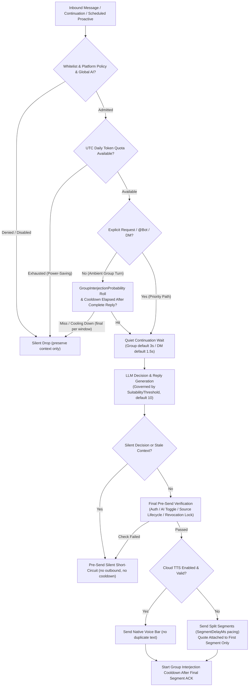
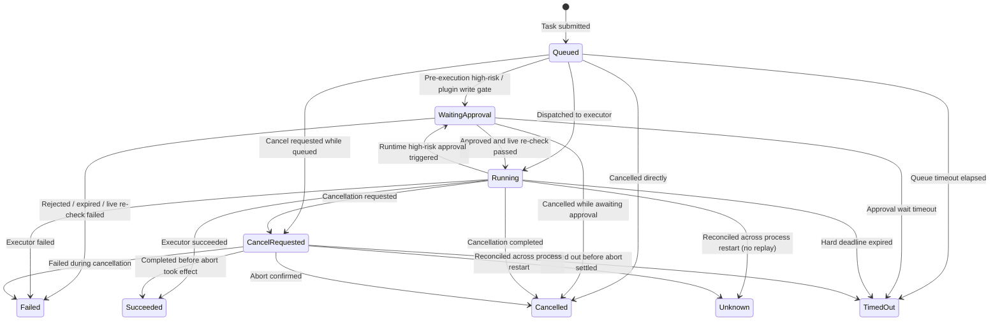
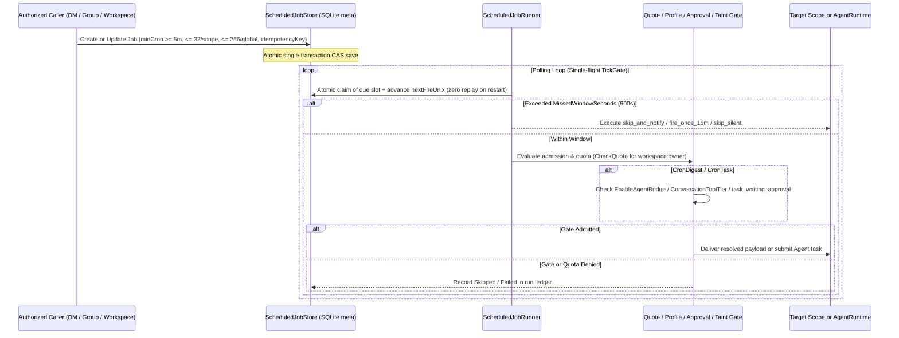

# Core Business Rules & Domain Guide

English | [简体中文](core-business-rules.md)

This document summarizes Bot Agent's runtime business rules, state machines, security isolation boundaries, and exception behaviors derived directly from the codebase. See also [API Surface Map](../api-surface.md), [Documentation Hub](../index.en.md), and [Consolidated Open Questions](../open-questions.en.md).

---

## 1. Multi-Platform Inbound Trust Boundaries

Bot Agent supports five isolated inbound channels. Every conversation is keyed by a normalized composite `source_key` / `ConversationId` separating platform, account instance, and target; message payloads never bleed across platforms.

| Channel | Protocol / Integration | Conversation & Identity Isolation | Inbound Validation & Trust Boundary |
| :--- | :--- | :--- | :--- |
| **QQ Private (OneBot)** | OneBot v11 Forward/Reverse WebSocket (NapCat) | `group:<group_id>` / `private:<qq_id>` (multi-account prefix when applicable) | Only verified protocol events set `IsReliableIdentity = true`; external `music`/`json`/`forward` cards cannot execute commands directly and are tagged `[分享卡片` / `[合并转发` (`OneBotInboundParser`, `BotConversation`) |
| **QQ Official Open Platform** | QQ Open API + Webhook/WS | `official:` prefix; openids mapped to `8e15+` numeric aliases | Credentials (`BOTAGENT_OFFICIAL_APP_SECRET`) are env-only; whitelists and `own_messages_scoped` are strictly isolated from private QQ |
| **Feishu (Lark)** | `FeishuWsClient` WS / Event Webhook | Native IDs mapped to `FeishuBase + 1e12`–`2e12` (stored in `data/feishu-ids-v2.json`) | `feishu_webhook_dedup` prevents replay; `p2p` missing sender fails closed (`missing_sender`); fallback `unknown_user` forces `IsReliableIdentity = false`; ping failures cancel `sessionCts` |
| **Local Playground Channel** | In-process `POST /api/local/message` | `local:<channel_id>` (must be registered in config) | Exercises the full LLM decision, quota, and tool governance pipeline without external gateways or `QqHost` |
| **Personal Workspace** | Owner-only Web Console workspace | Reserved key `workspace:owner` | Stored solely in `meta['workspace:owner:messages:v1']`; blocked from reading/writing external group or DM histories and excluded from `DescribeAllSessions()` |

> [!IMPORTANT]
> **Key Invariants**:
> - Sources with `IsReliableIdentity == false` can NEVER trigger high-trust actions (cross-platform identity linking challenges, human approvals, or admin elevation).
> - `own_messages_scoped` partitions outgoing bot messages by `(conversation_key, native_message_id)` so reply-quote attribution and recall verification never match across platforms; legacy bare-numeric `own_messages` rows are archived read-only.

---

## 2. Three-Layer Configuration & ConversationProfile Resolution

### 2.1 Configuration Ownership Layers

| Layer | Carrier | Owner | Precedence & Override Rules |
| :--- | :--- | :--- | :--- |
| **1. Compose Layer** | Root `.env` | Deployer | Used only for `${VAR}` substitution inside `docker-compose.yml`; not injected unless mapped under `environment:` |
| **2. Host Env Layer** | Process / Container `environment` | Host startup | Canonical `BOTAGENT_*` overrides `QQCHAT_*` (with `{NAME}_FILE` secret-file support); **secrets are never written to `settings.json`**; infrastructure values override on every start |
| **3. DB Truth Layer** | SQLite `settings` + `configuration_*` | Web Console & Runtime | Behavioral settings (persona, whitelists, thresholds, pacing) seed from env only when DB has no saved state; once saved in Console (CAS + singleflight), DB owns them exclusively |

### 2.2 Capability Intersection Chain

For every inbound message or background turn, effective capabilities are computed monotonically (**strictly tighten, never widen**) across `PlatformPolicyResolver` and `ConversationProfileResolver` (see [Platform Policy Resolution](../architecture/platform-policy-resolution.md) and [Conversation Profile Resolution](../architecture/conversation-profile-resolution.md)):

```text
Global Toggles (AppSettings / Plugin Package Enablement)
   ∩ Platform Policy (PlatformPolicy: ToggleRule + ListRuleKind + Feature)
   ∩ Conversation Profile (ConversationProfile: Conversation & Tool Tiers + Feature Overrides)
   ─────────────────────────────────────────────────────────────────────────────────────────
   = EffectiveConversationSettings (Active turn capabilities)
```

- **Platform Toggle vs Chat Mute**: Disabling **Chat** (`chatEnabled = false`) keeps underlying gateway connections and background maintenance alive; disabling the **Platform** blocks inbound/outbound chat pipeline execution entirely.
- **Canonical Feature Keys**: All legacy import and runtime policy paths normalize enum keys to snake_case (e.g., `PlatformFeatureId.PersonalTodo` -> `"personal_todo"`).

---

## 3. Reply Pacing, Suitability & Silent Short-Circuit

Bot Agent replaces legacy desire/cooldown heuristics with one unified **Reply Pacing** scheduler (see [Reply Pacing Specification](../reply-pacing.md)):



### Reply Pacing Invariants

1. **Per-Conversation FIFO Serialization**: At most one active generation/delivery owner runs per conversation; explicit requests skip behind-chat starvation; bounded coordinator caps at **256** active items with rate-limited busy notices (`<= 1` per 30s per conversation).
2. **Single Roll per Continuation Window**: Ambient group turns failing probability roll or cooldown never re-roll inside timer retries or fallbacks.
3. **Pre-Send Short-Circuit**: Silent decisions, stale contexts, or cancellations abort before dispatch without consuming cooldown.
4. **Single Quote & Audio/Text Exclusion**: Only the **first** sent segment carries a reply quote ID; successful voice-bar delivery suppresses duplicate text.
5. **Exact Cooldown Anchor**: `GroupInterjectionCooldownSeconds` (`0–3600s`) starts **only** after the final segment of a complete text/voice reply succeeds.

---

## 4. Tiered Memory, Knowledge Base & Taint Matrix (ADR-0004 / ADR-0005)

### 4.1 Memory Sensitivity × Tool Egress Matrix

To block privacy exfiltration across outbound search, external tools, or global shared state, each turn evaluates its highest consumed `MemorySensitivityTier` against every tool's `ToolEgressClass` in fail-closed fashion ([ADR-0005](../decisions/0005-memory-tool-coexistence-taint-tiers.md)):

| Highest Consumed Tier | `LocalPresentation` (0)<br/>Stickers/TTS/Poke/Segments | `SameScopeRead` (1)<br/>`doc.read`/`chat.digest`/`kb.*`/`reminder.list`/`todo.list` | `ExternalReadEgress` (2)<br/>`web.*`/`music.*`/Read-Only MCP/Unclassified | `ExternalSideEffect` (3)<br/>`ServerAgent`/Approval Writes/Workers | `GlobalStateWrite` (4)<br/>`_mood`/Room Vibes/`_research`/Agent History |
| :--- | :---: | :---: | :---: | :---: | :---: |
| `None` (0) | Allowed | Allowed | Allowed | Standard Gate | Allowed |
| `StylePreference` (L1) | Allowed (destination + lock) | Allowed | Allowed (no `_research` cache write) | **Denied** | **Denied** |
| `PersonalFact` (L2) | Allowed (pinned target only) | Allowed | **Strictly Denied** (exfil protection) | **Denied** | **Denied** |
| `LegacyProfile` (L3) | **Denied** | **Denied** | **Denied** | **Denied** | **Denied** |

- **Immediate Revocation**: All outbound renderers and writes re-verify `MemoryUseScope.CanUse` / `TryUse` / `TryDeliver` destination locks before execution.
- **Scoped Community Memory Budgets**: `ScopedCommunityMemoryService` bounds injected snippets (`1200` chars/item, `MaxContributorChars = 2400`).

### 4.2 Scoped Knowledge Base Rules

- **Physical Scope Isolation**: `KnowledgeStore` hashes composite scopes into `meta['knowledge:scope:v1:<sha256>']`—there is zero cross-group or group-to-DM search surface.
- **Hard Capacity Caps**: **256 docs**, **4096 chunks**, **120,000 chars/doc**, and **1 MiB** total serialized payload per scope (`scope_payload_too_large`); managed BM25 index (`k1=1.2, b=0.75`, unicode61 + CJK 2-grams) runs under an **8 MiB / 16-scope** LRU cap with generational invalidation.

---

## 5. Agent Task Runtime, RBAC & Approval State Machine

### 5.1 Explicit State Machine (`AgentTaskState` & `AgentTaskTransitions`)

Only `AgentTaskRuntime` advances task state. ZBA exposes states `0..7` and projects `TimedOut` (`8`) onto `Failed` with `errorCode = "timeout"` ([ADR-0002](../decisions/0002-agent-task-runtime.md), [ADR-0003](../decisions/0003-agent-task-persistence.md)):



- **Five Irreversible Terminal States**: `Succeeded` (3), `Failed` (4), `Cancelled` (6), `Unknown` (7), and `TimedOut` (8) have zero outgoing transitions; late callbacks cannot mutate them.
- **Restart Reconciliation**: On startup, any non-terminal row in `agent_tasks` from an earlier `boot_seq` transitions immediately to `Unknown` and is **never auto-replayed**.

### 5.2 RBAC & Tool Approval Boundaries

| Role (`WorkspaceRole`) | Level | Core Boundary |
| :--- | :---: | :--- |
| `Guest` | 0 | **No Legacy Elevation Fallback**: Once explicitly bound below `GroupManager`, cannot fall back to QQ `msg.SenderRole` |
| `Member` | 1 | Standard conversation & permitted same-scope read queries only |
| `TrustedMember` | 2 | Policy-admitted standard interactions |
| `GroupManager` | 3 | Scoped management operations subject to platform whitelists & plugin grants |
| `BotOwner` | 4 | Full owner capabilities inside bound scope; `workspace:owner` requires no QQ `QqHost` |

- **Non-Read-Only Plugin Tool Loop**: Non-read-only `ToolOrigin.Plugin` tools pass `approvalsEnabled`; both approval decision and `ExecuteApprovedRealToolAsync` re-verify global approval switches, conversation permissions, capability fingerprints (including `ConversationProfiles`), and live RBAC state right before execution.
- **Ops Command Hardening**: `//sessions all` and `//status` require `isOpsAuthorized`; non-QQ scopes, `workspace:owner`, and `st-` scheduled tasks strictly disable `QqHost`.

---

## 6. Scheduler, Personal Todos, Identity Linking & Personal Workspace



### Domain Limits & Privacy Invariants

1. **Scheduler (`SchedulerLimits`)**: Default timezone `Asia/Shanghai`, min Cron interval **5 min**, **32/scope**, **256/global** (hard storage cap 512), payload `<= 2048 B`, run ledger `1024` rows, idempotency receipts `64` (`idempotencyKey <= 128`, no control chars). Read-only `/zba/v1/scheduler/jobs` always masks `ScopeKey` (`MaskedScope`) and redacts `Text` as `"[受保护]"`, even when `AgentMaskSensitive == false`.
2. **Personal Todos (`PersonalTodoLimits`)**: Hashed per `ownerScopeKey` (`personal_todo:scope:v1:<sha256>`), `<= 256` items/person, title `<= 200` chars, note `<= 1000` chars, states `open` / `done` / `archived`, priority `1–3`. Sandboxed UI writes require `mode === 'admin'` and authenticated session checks.
3. **Optional Identity Linking ([ADR-0006](../decisions/0006-optional-cross-platform-identity-linking.md))**: Disabled by default; never infers matches from nicknames or usernames. Requires both endpoints to be **DM scopes with `IsReliableIdentity == true`**, exchanging an in-memory **120s** one-time HMAC challenge before persisting to `identity_links:v1`. Only optional `personal_todos`, DM `knowledge:scope` (never group KBs), and L1/L2 preferences may be shared—never chat logs, group RBAC, approval authority, or unified memory admin authority.
4. **Personal Workspace (`workspace:owner`)**: Retains up to **200** messages, `<= 16,000` chars/message, `<= 512 KiB` total ledger, `64` idempotency receipts; enforces platform-neutral prompt overlays and explicit AI/quota gates.

---

## 7. Boundary Conditions & Exception Matrix

| Boundary / Failure Mode | Trigger Condition | Runtime Behavior (Fail-Closed) | Source / Reference |
| :--- | :--- | :--- | :--- |
| DB Schema Newer Than Host | `PRAGMA user_version > 15` | Throws `database_schema_newer` and aborts startup | `AppDatabase.cs` |
| Config Revision Newer | `meta['configuration_schema'] > 1` | Throws `configuration_schema_newer` and aborts startup | `AppDatabase.cs` |
| Nested Write Reentrancy | Callback invokes `AppDatabase.Write` or backup recursively | Throws `database_nested_write` to prevent deadlock | `AppDatabase.cs` |
| Corrupt JSON Ledger | Deserialization failure in KB/scheduler/todo/workspace/identity store | Quarantines raw bytes to `<key>:corrupt`, resets safely to empty | `Storage/*Store.cs` |
| Missing ZBA Token | Unset `BOTAGENT_ZBA_TOKEN` outside loopback dev mode | All management endpoints except `/zba/v1/health` return `503` | `ZbaRuntimeContext.cs` |
| Knowledge Scope Overflow | Scope JSON exceeds `1 MiB` (`AbsoluteMaxScopeBytes`) | Rejects write with `scope_payload_too_large` | `KnowledgeStore.cs` |
| MCP Config Overflow / SSRF | Payload `> 64 KiB` or private/loopback/invalid endpoint URL | Rejected pre-save; Bearer stored exclusively in `secrets` table | `McpServerStore.cs` |
| Daily Token Quota Exhausted | Tenant UTC `used_prompt + used_completion >= daily_token_limit` | Switches tenant to power-saving silent mode | [Token Quota Plugin](../token-quota-plugin.md) |
| Provider Circuit Open | `model_providers.consecutive_hard_failures` hits threshold | Enters `cooldown_until`; router hot-fails over to next priority | [Model Configuration Apply Path](../architecture/model-configuration-apply-path.md) |
| Card / Plugin Tool Injection | Forwarded/music/JSON cards with commands; unapproved plugin tools | Cards stripped from command path; unapproved tools blocked in `ChatCapabilitySet` + pre-exec re-check | `OneBotInboundParser.cs`, `ApprovalUseCase.cs` |
