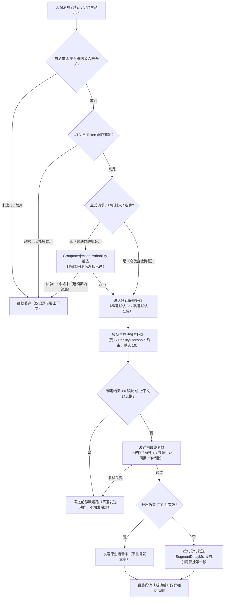
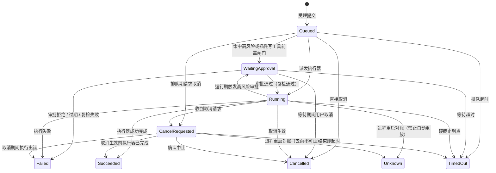
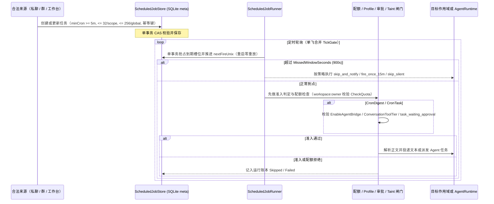

# 核心业务规则与领域说明

简体中文 | [English](core-business-rules.en.md)

本文基于当前代码实现提炼 Bot Agent 的核心业务规则、状态流转、安全隔离边界与异常处理逻辑；接口契约清单与低层模块拓扑另见 [接口地图](../api-surface.md) 与 [文档总目录](../index.md)。

---

## 1. 多平台入站与身份信任边界

宿主支持五类彼此隔离的入站来源，所有会话均以规范化的复合会话键（`source_key` / `ConversationId`）区分平台、实例与会话，绝不跨平台混读消息正文。

| 通道 | 协议与接入方式 | 会话/身份标识隔离 | 关键入站校验与信任边界 |
| :--- | :--- | :--- | :--- |
| QQ 私域（OneBot） | OneBot v11 Forward/Reverse WebSocket（NapCat） | `group:<群号>` / `private:<QQ号>`（多实例带账号前缀） | 仅可信协议事件置 `IsReliableIdentity = true`；外部 `music`/`json`/`forward` 卡片禁止直接执行命令，正文打标 `[分享卡片` / `[合并转发` 视为不可信衍生文本（`OneBotInboundParser`、`BotConversation`） |
| QQ 官方开放平台 | QQ Open API + Webhook/WS | `official:` 前缀；openid 映射为 `8e15` 起别名号 | 凭据（`BOTAGENT_OFFICIAL_APP_SECRET`）仅读环境变量；与私域白名单、已发消息台账（`own_messages_scoped`）完全隔离 |
| 飞书（Feishu） | `FeishuWsClient` 长连 / Webhook 回调 | 原生 ID 映射至 `FeishuBase + 1e12`–`2e12` 号段（持久化于 `data/feishu-ids-v2.json`） | `feishu_webhook_dedup` 防重放；私聊（`p2p`）缺失发送者直接拒绝（`missing_sender`）；回退标识 `unknown_user` 时强制 `IsReliableIdentity = false`；Ping 失败主动取消 `sessionCts` |
| 本地调试通道 | 进程内直投 `POST /api/local/message` | `local:<通道ID>`（需在配置中登记） | 完整经过模型研判、配额与工具治理流水线；不经外部协议端，不赋予 `QqHost` 能力 |
| 个人工作台 | 本人 Web 工作台专属会话 | 固定保留键 `workspace:owner` | 仅保存于 `meta['workspace:owner:messages:v1']`，严禁读写任何外部群聊/私聊消息；从 `DescribeAllSessions()` 与普通平台会话列表排除 |

> [!IMPORTANT]
> **关键不变量**：
> - `IsReliableIdentity == false` 的来源绝对不能触发需要强身份认证的能力（如跨平台身份挑战、审批裁决、管理员提权）。
> - `own_messages_scoped` 按 `(conversation_key, native_message_id)` 隔离存储机器人自己的消息，防止引用解析或撤回判定跨平台误命中；历史裸数字 `own_messages` 仅作存量保留，禁止从中反推作用域。

---

## 2. 三层配置模型与会话级 Profile 裁决

### 2.1 配置三层所有权

| 层级 | 载体 | 所有者 | 生效与覆盖规则 |
| :--- | :--- | :--- | :--- |
| ① Compose 层 | 根目录 `.env` | 部署者 | 仅做 `docker-compose.yml` 的 `${VAR}` 占位替换，不会自动进入容器环境 |
| ② 宿主环境变量层 | 进程/容器 `environment` | 宿主启动读取 | 规范前缀 `BOTAGENT_*` 优先，兼容 `QQCHAT_*`（含 `{NAME}_FILE` 读取密钥文件）；**密钥永不写入 `settings.json`**；基础设施变量（模型地址/协议端地址/端口）每次启动覆盖 |
| ③ 数据库真源层 | SQLite `settings` + `configuration_*` | 控制台与运行时 | 行为类配置（人设、白名单、阈值、节奏、开关）在首次无库时以环境变量为种子；面板保存（CAS 乐观锁 + 单飞限流）后即由库独占，改 `.env` 不再覆盖 |

### 2.2 会话能力三级解析链

针对每一条入站或后台轮次，能力有效性由 `PlatformPolicyResolver` 与 `ConversationProfileResolver` 按以下顺序**只收紧、不放宽**地合并裁决（详见 [平台策略解析](../architecture/platform-policy-resolution.md) 与 [会话配置解析](../architecture/conversation-profile-resolution.md)）：

```text
全局开关 (AppSettings / 插件包启用态)
   ∩ 平台策略 (PlatformPolicy: ToggleRule + ListRuleKind + Feature)
   ∩ 会话 Profile (ConversationProfile: 对话/工具分层与特性开关)
   ─────────────────────────────────────────────────────────
   = EffectiveConversationSettings (本轮实际生效能力)
```

- **平台开关 vs 聊天静音**：关闭**聊天**（`chatEnabled = false`）时保留底层连接与后台维护；关闭**平台**时直接阻止该平台的消息进入模型对话与发送链。
- **特征键规范**：所有功能枚举在旧配置兼容导入与运行时策略解析均映射到规范小写键（如 `PlatformFeatureId.PersonalTodo` 映射为 `"personal_todo"`）。

---

## 3. 回复节奏、适合度判定与静默短路

Bot Agent 废弃了早期的“欲望值/独立参与状态机”模型，统一采用单一**回复节奏调度器（Reply Pacing）**（参见 [回复节奏规范](../reply-pacing.md)）。



### 核心业务不变量

1. **单会话 FIFO 串行**：同一会话最多 1 个生成/发送拥有者，高优先级显式请求不被普通闲聊插队；有界协调器上限 **256** 项，过载时触发受限流保护的忙提示（单会话 30 秒最多 1 次）。
2. **连续输入只抽签一次**：一次普通群聊机会在连续输入窗口内抽签或冷却失败即终局，续话定时器与回退路径**不得**重复抽签绕过。
3. **静默短路在发送之前**：模型判定静默、输入过期（stale）或撤回/停止发生时，在提交发送前直接销毁，不消耗冷却、不发送半截消息。
4. **引用唯一与音文互斥**：分句发送时**仅第一段**携带引用回复 ID；语音合成成功发出后不重复播报同内容文字。
5. **冷却起点精确**：`GroupInterjectionCooldownSeconds`（0–3600s）仅在完整聊天回复的**最后一段确认发送成功**后开始计时；失败/部分成功/仅戳一戳/仅表情包不计入完整聊天冷却。

---

## 4. 分层记忆、知识库与防污染矩阵（ADR-0004 / ADR-0005）

### 4.1 统一记忆敏感度与工具流出面共存矩阵

为防止通过外网检索、工具调用或跨轮全局状态将个人隐私泄漏，引擎在每轮消费记忆时计算 `MemorySensitivityTier`，与每个工具声明的 `ToolEgressClass` 执行二维 Fail-Closed 裁决（[ADR-0005](../decisions/0005-memory-tool-coexistence-taint-tiers.md)）：

| 最高敏感度等级 | `LocalPresentation` (0)<br/>表情包/语音/戳一戳/分句 | `SameScopeRead` (1)<br/>`doc.read`/`chat.digest`/`kb.*`/`reminder.list`/`todo.list` | `ExternalReadEgress` (2)<br/>`web.*`/`music.*`/只读 MCP/未分类 | `ExternalSideEffect` (3)<br/>`ServerAgent`/审批写入/Worker | `GlobalStateWrite` (4)<br/>`_mood`/全局氛围/`_research`/Agent历史 |
| :--- | :---: | :---: | :---: | :---: | :---: |
| `None` (0) 未消费记忆 | 允许 | 允许 | 允许 | 按常规权限 | 允许 |
| `StylePreference` (L1 表达偏好) | 允许（含目的地+撤销锁校验） | 允许 | 允许（禁写研究缓存） | **拒绝** | **拒绝** |
| `PersonalFact` (L2 个人事实) | 允许（仅当前限定目标） | 允许 | **严格拒绝**（防提示词注入外泄） | **拒绝** | **拒绝** |
| `LegacyProfile` (L3 旧画像自由文本) | **拒绝** | **拒绝** | **拒绝** | **拒绝** | **拒绝** |

- **撤销即时生效**：所有外部渲染与记忆写入前必须再过 `MemoryUseScope.CanUse` / `TryUse` / `TryDeliver` 目的地绑定锁校验。
- **社区记忆分片预算**：`ScopedCommunityMemoryService` 读取跨轮片段严格截断（单条 `1200` 字符、`MaxContributorChars = 2400`）。

### 4.2 会话轻量知识库规则

- **物理作用域隔离**：`KnowledgeStore` 将不同复合作用域哈希后写入 `meta['knowledge:scope:v1:<sha256>']`，群与群、群与私聊之间无全局检索入口。
- **硬容量护栏**：单作用域上限 **256 篇文档**、**4096 个切片**、单篇输入 **120,000 字符**、单作用域总持久化载荷 **1 MiB**（超出返回 `scope_payload_too_large`）；内置纯托管 BM25 索引（`k1=1.2, b=0.75`，英文 unicode61 + 中日韩 2-gram）受 **16 个作用域 / 8 MiB** LRU 内存上限控制，并带代际版本失效防脏读。

---

## 5. Agent 任务运行时、RBAC 与审批状态机

### 5.1 显式任务状态机（`AgentTaskState` & `AgentTaskTransitions`）

任务状态只能由引擎层的 `AgentTaskRuntime` 推进，外部通道（ZBA / 面板 / 聊天）禁止私自改写状态；ZBA 契约仅暴露前 8 个枚举值，`TimedOut` (8) 在 ZBA 侧投影为 `Failed` + `errorCode = "timeout"`（详见 [ADR-0002](../decisions/0002-agent-task-runtime.md) 与 [ADR-0003](../decisions/0003-agent-task-persistence.md)）。



- **5 个终态不可逆**：`Succeeded` (3)、`Failed` (4)、`Cancelled` (6)、`Unknown` (7)、`TimedOut` (8) 没有任何出边，迟到的执行回调不得覆盖终态。
- **重启收口策略**：启动对账时发现 `boot_seq` 属于上一代进程且仍处于非终态（如 `Running` / `CancelRequested`）的任务，统一标为 `Unknown`，**绝不自动重新执行**（防止重复外部副作用）。

### 5.2 RBAC 与工具审批边界

| 角色层级（`WorkspaceRole`） | 等级值 | 核心边界 |
| :--- | :---: | :--- |
| `Guest` | 0 | **显式降权不回退**：一旦 RBAC 显式绑定为低于 `GroupManager`（含 `Guest`），禁止再回退读取 QQ 群内原生 `msg.SenderRole` 提权 |
| `Member` | 1 | 仅可触发常规对话与允许的同源只读查询 |
| `TrustedMember` | 2 | 允许受策略放行的常规交互 |
| `GroupManager` | 3 | 可在对应范围参与受控管理动作（仍受通道白名单与插件权限约束） |
| `BotOwner` | 4 | 可在对应绑定作用域操作高权限能力；工作台 `workspace:owner` 不依赖 QQ `QqHost` |

- **插件非只读工具审批闭环**：所有非只读 `ToolOrigin.Plugin` 工具纳入 `approvalsEnabled` 审批门槛（`ChatCapabilitySet`）；点击批准或执行 `ExecuteApprovedRealToolAsync` 前，**再次实查**当下的全局审批开关、会话权限、能力指纹（含 `ConversationProfiles` 指纹）及角色授权，任一失效则 Fail-Closed 拒绝。
- **运维命令鉴权收紧**：`//sessions all` 与 `//status` 严格要求 `isOpsAuthorized`；非 QQ 会话、`workspace:owner` 与 `st-` 调度任务一律禁用 `QqHost`。

---

## 6. 定时任务、个人待办、跨端身份与个人工作区



### 各领域模块硬规则

1. **定时任务（`SchedulerLimits`）**：
   - 默认时区 `Asia/Shanghai`；Cron 最小间隔 **5 分钟**；单作用域上限 **32** 个、全局 **256** 个（存储硬上限 512）；Payload 上限 **2048 字节**；运行账本保留最近 **1024** 条、幂等回执 **64** 条（`idempotencyKey <= 128` 且无控制字符）。
   - **安全与脱敏红线**：只读视角查询 `/zba/v1/scheduler/jobs` 时，`ScopeKey` 强制脱敏为 `MaskedScope`，`Text` 强制替换回传 `"[受保护]"`（即使 `AgentMaskSensitive == false` 也无条件脱敏）。
2. **个人待办（`PersonalTodoLimits`）**：
   - 按 `ownerScopeKey` 哈希物理分桶（`personal_todo:scope:v1:<sha256>`）；单人上限 **256** 条，标题 ≤ 200 字符，备注 ≤ 1000 字符；状态枚举仅限 `open` / `done` / `archived`，优先级 `1–3`；沙箱 UI 读取/修改受会话级认证与 `mode === 'admin'` 等显式契约约束。
3. **可选跨端本人身份绑定（[ADR-0006](../decisions/0006-optional-cross-platform-identity-linking.md)）**：
   - **默认关闭**；禁止依据昵称、用户名或账号自动猜测合并。
   - 仅限两端均为 `IsReliableIdentity == true` 的**私聊端点**，发起后在纯内存生成 **120 秒**单次 HMAC 挑战码（重启自动作废），由另一私聊端验证确认后写入 `identity_links:v1`。
   - 允许共享项严格限制为可选的 `personal_todos`、私聊 `knowledge:scope`（群聊知识库永不参与）及 L1/L2 偏好；**绝对禁止**共享历史聊天正文、群管 RBAC 角色、人类审批权或统一记忆管理员身份。
4. **个人工作台（`workspace:owner`）**：
   - 上限保留 **200** 条消息、单条 ≤ **16,000** 字符、总账本 ≤ **512 KiB**、幂等回执 **64** 条；开启工作台读取插件工具并严格校验证件配额与全局 AI 状态；提示词覆盖层强制平台中立（不泄漏群聊上下文规则）。

---

## 7. 边界条件与异常处理对照表

| 场景 / 异常边界 | 触发条件 | 系统实际行为（Fail-Closed） | 代码依据 / 参考 |
| :--- | :--- | :--- | :--- |
| 数据库 Schema 版本过高 | 实库 `PRAGMA user_version > 15` | 启动直接抛出 `database_schema_newer` 并终止启动，禁止向下兼容强读 | `AppDatabase.cs` |
| 配置修订版本过高 | `meta['configuration_schema'] > 1` | 抛出 `configuration_schema_newer` 阻断启动 | `AppDatabase.cs` |
| 写事务重入 | 写回调内部再次触发 `AppDatabase.Write` 或在线备份 | 抛出 `database_nested_write` 拒绝，防止死锁 | `AppDatabase.cs` |
| JSON 账本损坏 | 知识库/调度/待办/工作台/身份绑定反序列化失败 | 写路径将原文隔离备份至 `<key>:corrupt`，当前状态安全降级为空并可恢复写入 | `Storage/*Store.cs` |
| ZBA 未配置管理员/只读令牌 | 生产模式未设置 `BOTAGENT_ZBA_TOKEN` 且未开启回环开发豁免 | 除 `/zba/v1/health` 外所有管理接口统一返回 `503`，不降级放行 | `ZbaRuntimeContext.cs` |
| 知识库载荷越界 | 单作用域总 JSON 超过 1 MiB（`AbsoluteMaxScopeBytes`） | 拒绝写入并返回错误码 `scope_payload_too_large` | `KnowledgeStore.cs` |
| MCP 服务器配置越界 / SSRF | 配置 JSON 超 64 KiB 或端点指向内网保留段/非法协议 | 保存前拦截拒绝；Secret 单独落库 `secrets` 表且绝不回显 | `McpServerStore.cs` |
| 每日 Token 配额耗尽 | 某租户当日 UTC `used_prompt + used_completion >= daily_token_limit` | 自动切入节能静默，跳过自动聊天与主动触发 | [Token 配额说明](../token-quota-plugin.md) |
| 模型主节点连续硬失败 | `model_providers.consecutive_hard_failures` 达 `3` 次 | 状态切换至 `open` 并冷却 **`120` 秒**（`cooldown_until`），期满单次探测 `half_open`，路由热切次优先级供应商 | [模型配置应用路径](../architecture/model-configuration-apply-path.md) |
| 未知或高危命令注入 | 外部转发/音乐/JSON卡片夹带指令；非只读插件未审批 | 卡片直接拦截指令解析；未审批插件工具在 `ChatCapabilitySet` 与执行前复检双层拦停 | `OneBotInboundParser.cs`, `ApprovalUseCase.cs` |

---

## 8. 已确认的容错、限流与治理基线

1. **模型供应商熔断阈值与冷却窗口**：`ProviderCircuitBreaker` 与 `ProviderFailoverRunner` 默认固定为连续硬失败（5xx / 429 / 连接失败 / 超时）**`3` 次**触发 `open` 熔断，默认冷却 **`120` 秒**，冷却结束后仅放行单次 `half_open` 探测（进程重启清零 `ProbeInFlight`）；状态持久化于 `model_providers`。为防止误配造成级联故障，熔断阈值故意**不作为**控制台可调配置项暴露，运维通过控制台的「测试连接 / 启用停用 / 调整优先级」触发免重启路由热重建。
2. **企业通道限流（HTTP 429）退避与告警规范**：飞书（返回 `feishu_rate_limited`，默认提示 5 秒）与 QQ 官方通道（HTTP `429` 或业务码 `40034100`，透传 `Retry-After`）在出站发送遇到限流时，统一执行 **Fail-Closed 零盲目自动重试**（`ReplyDeliveryResults.StopsFurtherSending` 立即中止分句后续段发送，防止重复投递或触发平台封禁）；同时记录脱敏日志并写入 `/zba/v1/events` 事件环，持续出现限流尖峰时由外部监控触发人工告警。
3. **统一记忆管理员密钥交接与轮换**：`BOTAGENT_UNIFIED_MEMORY_ADMIN` 为宿主机注入的 JSON 身份绑定（包含精确键 `PlatformId`、`AccountScope`、`InstanceId`、`NativeUserId`），与普通 Agent 白名单完全隔离。运维人员交接或离职时须立即轮换，常规至少每 **90 天（每季度）** 复核一次；更新宿主密钥/环境变量并执行容器重建（`docker compose up -d`）生效，变更操作通过审计日志留痕。
