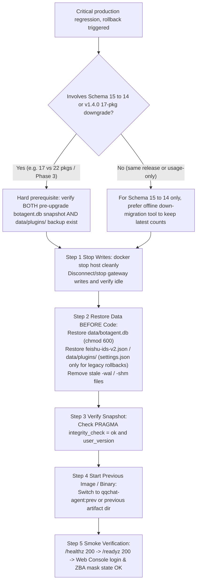

# Operations & Incident Runbook

English | [简体中文](runbook.md)

This runbook guides production on-call operations and incident recovery for Bot Agent under one governing principle: **protect user privacy and data integrity first, restore core availability second, then isolate root cause**. See also [Documentation Hub](../index.en.md).

> [!CAUTION]
> **Privacy & Log Inspection Redline**:
> Production logs and SQLite databases contain real group chat messages and member identities. **NEVER run raw `tail -n 200 qqchat.log` or unfiltered `docker logs`**. Always filter strictly for error markers and pipe through [`tools/mask-cjk.py`](../../tools/mask-cjk.py) to mask CJK text before inspecting:
> ```sh
> grep -aE 'ERROR|Exception|Unhandled|Traceback' <RuntimeRoot>/logs/qqchat.log | tail -30 | python3 tools/mask-cjk.py
> ```

---

## 1. Core Observability Metrics & Endpoints

Bot Agent avoids heavy external agents like Prometheus and exposes operational health through built-in HTTP probes, read-only ZBA CLI commands, SQLite tables, and rotating logs:

| Signal / Metric | Inspection Endpoint / Query | Healthy Baseline | Alert / Anomaly Threshold |
| :--- | :--- | :--- | :--- |
| **Liveness & Build Version** | `GET /healthz`<br/>`GET /zba/v1/health` | `200 OK`; `version` matches `Directory.Build.props` | Non-200 or port unresponsive |
| **Protocol Readiness** | `GET /readyz` | `200 OK` | `503` (host alive, OneBot / enabled gateway disconnected) |
| **Component & Governance Summary** | `GET /zba/v1/status` (Read/Admin Bearer) or CLI `--status` | `status: "ready"`; no faulted components | `status: "degraded"`, `backup` `stale`/`faulted`, or `unified-memory` errors |
| **DB & Log Footprint** | `GET /status` → `ops.database.bytes`, `ops.logs.bytes` | Steady growth; `logs/qqchat.log` rotates at `>= 10 MiB` or daily (7-day gzip retention) | Unrotated log spike filling host disk |
| **Daily Hot Backup Health** | `GET /status` → `ops.backups`, `GET /api/backup`, `meta['backup_last_*']` | Hourly check after 10 min delay; 1 `VACUUM INTO` snapshot/day (retains 3) | `stale: true` (> 2 days since success) or non-empty `backup_last_failure` |
| **Memory, Swap & Restarts** | `GET /status` → `ops.memory.{rssBytes,usedPercent,swapUsedBytes,swapTotalBytes}` & `ops.process.{uptimeSeconds,startups,restarts}` | Stable `restarts`; RSS within `mem_limit: 768m` | Rapidly rising `restarts` (OOM Killer) or sustained swap saturation |
| **Event Ring & Runtime Errors** | `GET /zba/v1/events?after=<seq>` or CLI `--events --after 0` | Continuous monotonic cursor advance | `resyncRequired: true` or recurring error events |
| **Slow LLM Traces & Prompt Cache** | SQLite `trace_archive` (`created_at, status_code`) | Low error rate; expected cache hits | Surge in non-200 `status_code` or `fallback_hops > 0` |
| **Daily Token Quota Waterline** | SQLite `token_usage` + `tenant_quotas` / plugin UI | Usage below `daily_token_limit` | Tenant hits ceiling and enters power-saving silence |
| **Quick Read-Only CLI Self-Check** | `BOTAGENT_ZBA_URL=... BOTAGENT_ZBA_READ_TOKEN=... dotnet BotAgent.Headless.dll --status` (also `--capabilities`, `--tasks`, `--zba-meta`) | Exit code `0`, safe masked JSON | Connection error or HTTP `401` / `503` |

---

## 2. Incident Troubleshooting Matrix (Symptom → Investigation → Resolution)

| # | Symptom | Investigation Steps | Resolution |
| :-: | :--- | :--- | :--- |
| 1 | **Exits immediately on start**: `database_schema_newer` or `configuration_schema_newer` | 1. Inspect `PRAGMA user_version;` and `meta['configuration_schema']`;<br/>2. Check whether the binary/image was accidentally downgraded | **Never edit version numbers manually**. Switch back to the newer build or follow the [Rollback Playbook](rollback-playbook.md) after stopping writes to restore a compatible snapshot |
| 2 | **`/healthz` 200 but `/readyz` 503** (QQ Private silent) | 1. Inspect NapCat container logs & WebUI login state;<br/>2. Compare `BOTAGENT_QQ_ONEBOT_PROTOCOL`, `URL`, and `ONEBOT_TOKEN`;<br/>3. Verify two hosts aren't logging into the same QQ account | Fix WS URL/token and restart host or protocol client; **never run two NapCat instances for the same QQ**—always stop old before starting new |
| 3 | **Feishu drops messages or logs decrypt/replay errors** | 1. Grep masked error logs for WS Ping timeout or crypto errors;<br/>2. Check `BOTAGENT_FEISHU_APP_SECRET`, `BOTAGENT_FEISHU_ENCRYPT_KEY`, and host clock skew;<br/>3. Check permissions on `data/feishu-ids-v2.json` | Fix host env secrets and restart; confirm `feishu_webhook_dedup` handles duplicates; restore `feishu-ids-v2.json` from backup if missing |
| 4 | **LLM replies fail, timeout, or failover repeatedly** | 1. Query recent `trace_archive` errors and `fallback_hops`;<br/>2. Inspect `model_providers` (`circuit_state`, `consecutive_hard_failures`, `cooldown_until`);<br/>3. Test `BOTAGENT_BASE_URL` connectivity & key with `curl` | Verify model gateway health and credentials; test provider connection in Web Console or adjust priorities / rotate API keys (hot-rebuilds without restart) |
| 5 | **Web Console loads blank screen** (`Unexpected token '<'`) | 1. Check `Content-Type`, HTTP status, and cache headers on `/web/assets/index-*.js`;<br/>2. Inspect reverse proxy rules (especially Caddy `redir` and unauth fallback) | Missing `/web/assets/*` must return `404` (no SPA fallback to `index.html`); unauth redirects must return `303` + `Cache-Control: no-store`; Caddy must use `redir * / 303`, then purge CDN cache |
| 6 | **All ZBA routes return `503` or `401`/`403`** | 1. Verify `BOTAGENT_ZBA_TOKEN` (admin) and `BOTAGENT_ZBA_READ_TOKEN` (read) in process env;<br/>2. Check if browser refresh/lock cleared in-memory token;<br/>3. Check auth rate-limit cooldown | Production requires `BOTAGENT_ZBA_TOKEN`; use Bearer token rather than legacy panel password; wait out auth lockout cooldown if triggered |
| 7 | **`.env` whitelist or persona changes ignored on restart** | 1. Grep startup log for panel-override warnings;<br/>2. Check if key is exposed in `docker-compose.yml` `environment:`;<br/>3. Respect env vs DB truth layers | Behavioral settings are owned by Console + SQLite once saved—save changes in Web Console; infrastructure vars must also be wired into `docker-compose.yml` + `up -d` |
| 8 | **Agent task stuck in `WaitingApproval` or becomes `Unknown` after restart** | 1. Inspect idempotency key (`POST /zba/v1/tasks/find`) and approval TTL;<br/>2. Check whether `boot_seq` incremented on host restart | Approve/reject valid `WaitingApproval` requests via authorized admin; **never auto-retry `Unknown` tasks** before manually verifying external side effects (see [Task Recovery Guide](task-recovery-guide.md)) |
| 9 | **Config/plugin save times out with ambiguous result** | Preserve the displayed operation/idempotency key (`cfg1:` or plugin key) | **Do NOT blindly click Save again**; switch to admin mode and run Check Previous Save (`POST /zba/v1/operations/find`) per [Operation Receipt Recovery](operation-receipt-recovery.md) |
| 10 | **Bot stays silent, or workspace/scheduler triggers fail** | 1. Check global AI toggle, platform toggles, and `ConversationProfile` feature flags;<br/>2. Check `preset.feature.token-quota` daily budget;<br/>3. For scheduler jobs, check `EnableAgentBridge` and tool tier | Inspect quota usage ([Token Usage Recovery](token-usage-recovery.md)), adjust platform/profile policies, and verify scheduler limits (`32/scope`, `256/global`) |
| 11 | **MCP tool unavailable, blocked, or connection refused** | 1. Verify MCP server is enabled and tool is in `AllowedTools`;<br/>2. Check SSRF filter (loopback/private CIDR or invalid URL scheme);<br/>3. Check Bearer token existence/validity | Tune timeout or `MaxResultBytes`; re-enter Bearer token cleanly (stored in `secrets`, never echoed); configure local MCP endpoints per host policy |
| 12 | **1 GB host freezes, swap saturates, or OOM restarts** | 1. Check `free -m` and `docker stats`;<br/>2. Verify no one ran source `Dockerfile` (`dotnet publish`) on the 1 GB host;<br/>3. Check `docker-compose.yml` `mem_limit` | **Never compile images on 1 GB hosts**—build `app.tar.gz` locally and use [`Dockerfile.app`](../../Dockerfile.app); verify `mem_limit: 768m` / `napcat 512m`; **never run `swapoff -a`**; restart stateless helper containers (not NapCat) if needed to reclaim swap |

---

## 3. Emergency Rollback Playbook & Decision Flow

When critical post-release issues occur—such as reverting from `22 packages + Phases 1–5` back to `v1.4.0` (`17 packages`)—strictly follow the [Rollback Playbook](rollback-playbook.md) sequence: **Stop Writes → Restore Dual Snapshot → Verify SQLite Integrity → Start Previous Image → Smoke Test**.



### Rollback Redlines

1. **Always restore data snapshots BEFORE starting old binaries**: Letting older binaries read newer databases or `data/plugins/` triggers `database_schema_newer` or `plugin_metadata_unreadable`.
2. **Reverting between `v1.4.0` and current builds requires restoring BOTH DB and `data/plugins/`**: Both share SQLite `user_version = 15`; reverting only the container image breaks package manifests and Phase 3 memory enums (`UnifiedMemoryFactCategory` 3..5).
3. **Fresh Install vs In-Place Upgrade Plugin Behavior**: The bare host ships only 9 `system.*` core & platform packages with **0 pre-installed `preset.feature.*` plugins** and **0 automatic startup downloads**—install needed features on demand via `/web/` Plugin Center from `ZhaoJun233/bot-agent-plugins` (`1.1.0+`). Existing instances upgraded in place keep cached `1.0.0` `host-distribution://` archives runnable and support smooth `1.0.0 -> 1.1.0` upgrade or uninstall via Plugin Center.
4. **Cross-host protocol migration**: Always shut down NapCat on the old host completely before starting NapCat on the new host.

---

## 4. Production SLAs, External Alerting & On-Call Governance

1. **Production RTO / RPO Targets**:
   - **RPO <= 24 hours** under daily `VACUUM INTO` snapshots + off-site sync (**RPO ~= 0** for planned upgrades via mandatory pre-upgrade dual snapshots).
   - **RTO <= 30 minutes** for container rollback (`qqchat-agent:prev` + local snapshot), and **<= 2 hours** for full host rebuild from off-site backups. Continuous WAL archiving (PITR) remains explicitly out of scope on 1 GB single-node hosts.
2. **External Real-Time Alerting Integration**: External pull-based probes (such as Uptime Kuma or external cron checks) poll `/healthz` and `/readyz` every **60s** and `/zba/v1/status` (using `BOTAGENT_ZBA_READ_TOKEN`) every **5 min**, routing Webhook / email / owner DM alerts without embedding heavy agents into the runtime whenever:
   - `/healthz` or `/readyz` fails (non-200) for **>= 2 consecutive checks**;
   - `backup.status` reports `stale` or `faulted`; or
   - `ops.process.restarts` increases by **>= 2 within 15 minutes**.
3. **Maintenance Approval & Rollback Sign-Off Ownership**: `BotOwner` / release owner approves maintenance windows, `dev -> main` PR merges, and version tags; the on-call operator holds **pre-authorized unilateral authority to trigger emergency rollback** on `/healthz`, `/readyz`, or integrity check failure, posting pre-maintenance notices, deployment receipts, and rollback summaries to the private ops channel / owner DM.

---

## 5. Related Operations Guides

- [Rollback Playbook & Drill Results](rollback-playbook.md)
- [Data Retention, Daily Hot Backups & Recovery Drills](data-retention-and-backup.md)
- [Agent Task Recovery Guide](task-recovery-guide.md)
- [Operation Receipt Recovery](operation-receipt-recovery.md)
- [Token Usage Offline Reverse Migration](token-usage-recovery.md)
- [Agent Runtime Deployment & Verification](agent-runtime-deployment.md)
