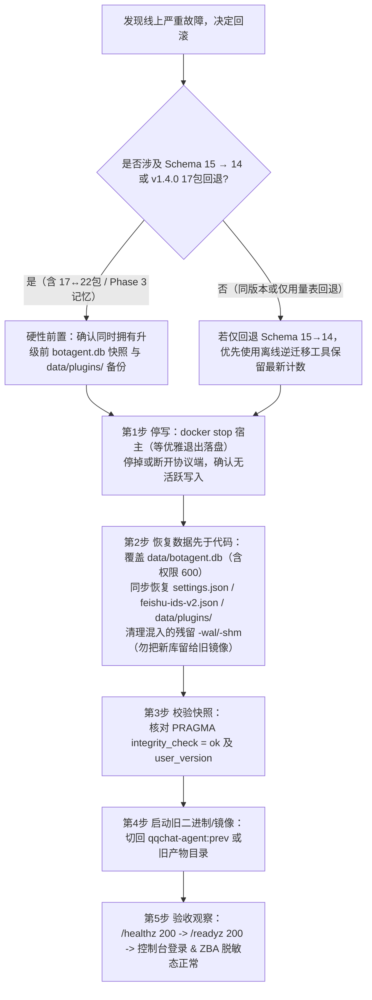

# 运维排障与应急手册（Runbook）

本手册面向 Bot Agent 线上运行值守与故障应急处置，原则为：**先保护数据与隐私、恢复核心服务，再定位根因**。

> **隐私安全红线（查阅生产日志必守）**：
> 真实环境下日志与数据库包含群聊正文与成员隐私，**严禁直接 `tail -n 200 qqchat.log` 或无过滤执行 `docker logs`**。只允许通过关键字筛选错误并经仓库内置 [`tools/mask-cjk.py`](../../tools/mask-cjk.py) 遮蔽中文后再观察：
> ```sh
> grep -aE 'ERROR|Exception|Unhandled|Traceback' <RuntimeRoot>/logs/qqchat.log | tail -30 | python3 tools/mask-cjk.py
> ```

---

## 1. 核心监控指标与观测入口

宿主未额外引入 Prometheus/独立监控 Agent，指标统一通过以下轻量化健康端点、CLI、数据库表与日志暴露：

| 监控对象 / 指标 | 获取入口 / 查询方式 | 正常口径 | 异常告警阈值 / 信号 |
| :--- | :--- | :--- | :--- |
| **进程存活与版本** | `GET /healthz`<br/>`GET /zba/v1/health` | `200 OK`，返回 `version` 与 `Directory.Build.props` 一致 | 非 200 或端口无响应 |
| **协议连接就绪度** | `GET /readyz` | `200 OK` | `503`（进程活着但未连上 OneBot/启用的协议端） |
| **系统组件与治理摘要** | `GET /zba/v1/status`（需 Read/Admin Bearer）或只读 CLI `--status` | `status: "ready"`，各组件非 `faulted`/`error` | `status: "degraded"`、`backup` 为 `stale`/`faulted`、`unified-memory` 报错 |
| **数据库与日志体积** | `GET /status` → `ops.database.bytes`、`ops.logs.bytes` | 稳定增长；`logs/qqchat.log` ≥10 MiB 或跨天自动 gzip 轮转留 7 天 | 日志未轮转暴涨占满磁盘 |
| **每日热备状态** | `GET /status` → `ops.backups`、`GET /api/backup`、`meta['backup_last_*']` | 首次启动 10 分钟后每小时检查并每日生成 1 份 `VACUUM INTO`（留 3 份） | `stale: true`（> 2 天未成功）或 `backup_last_failure` 非空（控制台顶部亮红条） |
| **内存、Swap 与重启次数** | `GET /status` → `ops.memory.{rssBytes,usedPercent,swapUsedBytes,swapTotalBytes}` & `ops.process.{uptimeSeconds,startups,restarts}` | `restarts` 稳定；RSS 在 `mem_limit: 768m` 内 | `restarts` 短时连续攀升（疑似 OOM Killer）或 Swap 持续高企 |
| **事件环与运行时错误** | `GET /zba/v1/events?after=<seq>` 或 CLI `--events --after 0` | 游标连续推进 | `resyncRequired: true` 或频繁写入错误事件 |
| **模型慢轨迹与缓存命中** | SQLite `trace_archive`（按 `created_at, status_code`） | 错误率低，Prompt Cache 命中合理 | `status_code` 非 200 激增或 `fallback_hops > 0` 频繁 |
| **每日 Token 配额水位** | SQLite `token_usage` + `tenant_quotas` / 插件界面 | 各租户用量低于 `daily_token_limit` | 触顶后进入节能静默（消息不回复） |
| **ZBA 只读 CLI 快捷自检** | `BOTAGENT_ZBA_URL=... BOTAGENT_ZBA_READ_TOKEN=... dotnet BotAgent.Headless.dll --status`（另支持 `--capabilities` / `--tasks` / `--zba-meta`） | 退出码 0，输出安全 JSON | 连接失败或 401/503 |

---

## 2. 常见故障排查矩阵（现象 → 排查步骤 → 解决方案）

| # | 故障现象 | 排查步骤 | 解决方案 |
| :-: | :--- | :--- | :--- |
| 1 | **启动即退出**：日志报 `database_schema_newer` 或 `configuration_schema_newer` | 1. 用 `sqlite3 <db> 'PRAGMA user_version;'` 与查询 `meta['configuration_schema']`；<br/>2. 核对当前二进制/镜像是否意外降级 | **禁止手改版本号欺骗校验**。要么切回新版本镜像；若确认需降级，必须停写后按 [回滚预案](rollback-playbook.md) 恢复升级前兼容快照 |
| 2 | **`/healthz` 200 但 `/readyz` 503**（QQ 私域无响应） | 1. 检查 NapCat 容器日志与 WebUI 在线状态；<br/>2. 比对 `BOTAGENT_QQ_ONEBOT_PROTOCOL`、`URL` 与 `ONEBOT_TOKEN`；<br/>3. 核对是否多机同时登录了同一个 QQ 号 | 修复 WS 地址/Token 后重启协议或宿主；**同一 QQ 禁止双协议端同时在线**，切机必须先停旧 NapCat 再起新机 |
| 3 | **飞书收不到消息或重复/解密报错** | 1. 过滤错误日志看 WS/Ping 超时或加解密错误；<br/>2. 检查 `BOTAGENT_FEISHU_APP_SECRET`、`BOTAGENT_FEISHU_ENCRYPT_KEY` 及事件时间偏差；<br/>3. 检查 `data/feishu-ids-v2.json` 权限与可读性 | 核正宿主机环境变量秘密并重启；若遇偶发重投，确认 `feishu_webhook_dedup` 正常工作；丢失 `feishu-ids-v2.json` 需从备份恢复 |
| 4 | **模型回复失败 / 超时 / 自动切换备用节点** | 1. 查 `trace_archive` 最近错误行及 `fallback_hops`；<br/>2. 查 `model_providers` 的 `circuit_state`、`consecutive_hard_failures`、`cooldown_until`；<br/>3. 用 `curl` 验证 `BOTAGENT_BASE_URL` 网关连通性与 Key 有效性 | 确认模型网关进程及密钥有效；在控制台「模型供应商」测试连接或重置节点优先级/替换 API Key（免重启热重建路由） |
| 5 | **Web 控制台打开白屏**（脚本报 `Unexpected token '<'`） | 1. 浏览器/Curl 检查 `/web/assets/index-*.js` 返回的 `Content-Type`、`HTTP 状态码` 与缓存头；<br/>2. 检查反代配置（特别是 Caddy 的 `redir` 与未认证回退块） | 缺失 `/web/assets/*` 必须回 `404`（禁用 SPA fallback 到 `index.html`）；未认证跳转走 `303` + `Cache-Control: no-store`；Caddy 须写 `redir * / 303` 而非 `redir / 303`；之后清 CDN 缓存 |
| 6 | **ZBA 管理接口全部 503，或只读/写操作报 401/403** | 1. 确认 `BOTAGENT_ZBA_TOKEN`（管理员）与 `BOTAGENT_ZBA_READ_TOKEN`（只读）是否已注入进程；<br/>2. 核对浏览器是否锁屏/刷新清除了内存令牌；<br/>3. 查是否触发认证失败限流 | 生产环境必须配置 `BOTAGENT_ZBA_TOKEN`；只读接口勿用普通面板密码代替 Bearer Token；限流后等待冷却窗口恢复 |
| 7 | **修改 `.env` 的白名单/人设后重启不生效** | 1. 过滤启动日志查看「已被面板设置覆盖」提示；<br/>2. 检查 `docker-compose.yml` 的 `environment:` 是否声明了该变量；<br/>3. 注意环境变量与 DB 真源边界 | 行为类配置在首次安装后由面板 + 数据库独占，改后请直接在 Web 控制台保存；基础设施变量改完需确保已写入 Compose `environment:` 并 `up -d` 重建容器 |
| 8 | **Agent 任务卡在 `WaitingApproval` 或重启后变成 `Unknown`** | 1. 在任务页核对幂等键（`POST /zba/v1/tasks/find`）与待批请求有效期；<br/>2. 确认是否涉及多实例或宿主刚重启（`boot_seq` 变化） | `WaitingApproval` 需由有权限管理员在有效期内批准/拒绝；重启收口为 `Unknown` 后**不得盲目点击重跑**，须人工核对外部副作用再决定（详见 [任务恢复指南](task-recovery-guide.md)） |
| 9 | **配置/插件保存时网络超时，提示“结果未确认”** | 保留页面展示的原操作键（`cfg1:` 或插件幂等键） | **切勿立刻再次保存**；切换至管理员后使用“核对先前保存”（`POST /zba/v1/operations/find`）查询真实回执状态（详见 [操作安全记录查询](operation-receipt-recovery.md)） |
| 10 | **机器人完全静默，或工作台/定时任务触发失败** | 1. 查全局 AI 开关、平台开关、会话 Profile 特征启用态；<br/>2. 检查 `preset.feature.token-quota` 每日额度是否耗尽；<br/>3. 若涉定时任务，查 `CronTask`/`CronDigest` 所需 `EnableAgentBridge` 与工具层级 | 额度耗尽见 [Token 用量恢复](token-usage-recovery.md)；调整对应平台策略与会话 Profile；确认定时任务作用域未超过 `32/scope` 或 `256/global` |
| 11 | **MCP 工具报错不可用 / 阻塞 / 连接被拒** | 1. 在系统配置 MCP 页面确认服务已启用且工具在 `AllowedTools` 白名单内；<br/>2. 核对端点是否触发 SSRF 防护（指向内网回环/保留网段或非合法 URL）；<br/>3. 核对 Bearer Token 是否存在或过期 | 按需调整超时与 `MaxResultBytes`；补填有效 Bearer（不回显，保存原子写入 `secrets`）；若为受控合法本地 MCP 服务需按当前托管策略配置 |
| 12 | **1 GB 低内存宿主机卡死、Swap 爆满或频繁 OOM 重启** | 1. `free -m` / `docker stats` 检查内存与 Swap 占用；<br/>2. 检查是否在服务器上误跑了源码 `Dockerfile` 的 `dotnet publish`；<br/>3. 检查 `docker-compose.yml` 资源限制 | **严禁在低内存机器直接编译镜像**，统一在开发机打 `app.tar.gz` 走 [`Dockerfile.app`](../../Dockerfile.app)；检查 `mem_limit: 768m` / `napcat 512m`；**切勿执行 `swapoff -a`**；可通过重启无状态配套容器（非 NapCat）释放僵死 Swap 页 |

---

## 3. 紧急回滚预案与决策流程

遇到上线后功能严重异常、数据异常或需要退回上一版本（如自 `22 包 + Phase 1–5` 回退至 `v1.4.0` 的 `17 包`）时，严格按 [回滚预案](rollback-playbook.md) 执行“**停写 → 验快照 → 恢复库与插件 → 恢复旧二进制/镜像 → 探活观察**”流程。



### 回滚红线提醒

1. **永远“先恢复数据快照，再启动旧版本程序”**：新版本库或高版本 `data/plugins/` 被旧版代码读取会触发 `database_schema_newer` 或 `plugin_metadata_unreadable`。
2. **`v1.4.0`（17 包）与当前候选（22 包）间回滚必须双份恢复**：两者 SQLite `user_version` 同为 `15`，若只退镜像不退 `data/plugins/` 与库，会引发现行包清单与 Phase 3 新增记忆枚举（`UnifiedMemoryFactCategory` 3..5）解析异常（`_faulted`）。
3. **跨机器迁移协议端**：先完全停掉旧机的 NapCat，再启动新机 NapCat，防止同一账号互踢触发平台风控。

---

## 4. 关联专项手册

- [回滚预案与实测演练](rollback-playbook.md)
- [日志保留、每日热备与恢复演练](data-retention-and-backup.md)
- [任务提交、审批、取消与恢复](task-recovery-guide.md)
- [查询先前操作的安全记录](operation-receipt-recovery.md)
- [Token 用量离线逆迁移](token-usage-recovery.md)
- [Agent Runtime 部署、验证与回滚](agent-runtime-deployment.md)

---

## 待确认信息清单

- [待确认: 生产环境具体的 RTO（恢复时间目标）与 RPO（恢复点目标）SLA 指标要求（当前默认仅保证每日 1 份本地 `VACUUM INTO` 热备，无连续 WAL 异地归档 PITR）。]
- [待确认: 出现 `restarts` 飙升、`backup` 失败或协议断连时，除每日定时健康日报私聊外，是否还对接了外部即时告警通道（如 Uptime Kuma / Webhook / 邮件）。]
- [待确认: 多人值守场景下的升级维护窗口审批人、通知群及回滚决策签字责任人分工。]
