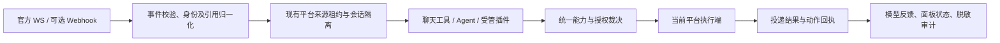

# QQ 官方通道能力完善计划

日期：2026-11-12。状态：**计划已编写，待评审；未授权实施、迁移、部署或开放权限。**

目标：让 QQ 官方群聊 / 单聊获得与私域一致的身份可信度、插件动作授权和可解释回执，接入官方已经提供的能力，并诚实呈现受限能力。不是把所有 OneBot 接口照搬到官方。

阅读顺序：本文 → [功能与证据对照](qq-official-parity-comparison-2026-11.md) → [执行及验收清单](qq-official-parity-execution-2026-11.md)。后两份分别承载证据编号 C / O 和任务、用例编号 P / T，本文不重复全部接口说明。

## 1. 范围与已确认决定

- 用户已确认：本轮先完善**各通道内的稳定身份识别**；官方与私域之间的账号绑定列为后续选项。不自动合并身份、画像、记忆、权限或历史会话。
- 本文的“官方”仅指 QQ 开放平台的群聊、C2C 单聊；QQ 频道 / 子频道不是 QQ 群，本轮不接入频道功能。
- 保持 .NET / Vue / Python 现有技术栈，以及平台注册、来源租约、统一工具、插件治理、审批、记忆隔离等现有机制。每次交付一个可以独立验证的行为切片。
- 现有平台 ID、`official:` 会话 key、已持久化别名、数据库 schema、secret ref 不因本计划直接改写。确需改变时另列兼容迁移设计并通过对应闸口。
- 当前没有核验任何真实 AppID 的接口授权、成员角色、群消息接收模式、生产配额或实际连接状态。“文档支持”“源码实现”“目标环境验收”分别记账。

## 2. 基线与主要结论

源码基线：`afbda550d44df6191e173561808eb280f83e6f46`。本计划从该提交建立独立文档工作树；现有产品代码、验收目录和生产环境均未修改。官方文档于 2026-11-12 读取，页面版本资源为 `v1.48.0`；变更记录最新条目为 2026-10-28。

| 优先级 | 已确认的源码 / 文档差距 | 直接影响 | 处理方向 |
| --- | --- | --- | --- |
| P0 | 群消息缺 `author.member_openid` 时将群 ID 当作用户；所有原生 ID 共用无类型映射 [C1/C2] | 缺失发送者可能成为貌似可靠的身份；用户、群、消息缺少类型边界 | 拒绝伪造发送者，传播身份可信度，保留旧别名并建立类型化映射 |
| P0 | `qq` Agent 宿主要求 `IQqActions`，又显式只放行 `qq.private` [C5] | 官方即使具备某个 HTTP 能力，也不能执行对应 Agent 动作 | 复用动作目录和工具治理，接入按平台、会话、角色裁决的执行端 |
| P0 | 文本被动发送任何失败都会再试主动发送；`11253` 被视作可刷 token；错误返回原文片段 [C3] | 失败分类不准确、权限拒绝后仍重试、日志可能带敏感数据 | 结构化错误、禁止不确定重放、最小化日志 |
| P1 | 官方事件文档已有 `username/member_role/bot`、引用结构；当前只取 ID、文本和图片 [C1/O4] | 缺角色与机器人识别，引用和语音附件信息丢失 | 归一化事件及来源证明，按字段能力补齐 |
| P1 | 官方已提供撤回、禁言、群信息等；成员查询 / 移除为内邀 [O5–O9] | 历史注释“官方没有”已不准确 | 分为普通能力、申请能力和仍无证据能力，按授权启用 |
| P1 | 统一 5 分钟窗口、最近一条消息引用和不断累加的序号 [C3] | 忽略 C2C 60 分钟 / 4 次、群 5 分钟 / 5 次；易错绑本轮触发消息 | 将触发引用、预算、回执绑定到一次操作 |
| P2 | 图片、语音有发送实现；音乐只能发文字；按钮 / Markdown 未接入 [C1/O2/O3/O10] | 用户无法判断是成功降级还是完全失败 | 明确降级结果，再增加官方原生交互 |

这些是静态源码和公开接口资料的结论，**不是线上故障复现或实现验收报告**。

## 3. 目标机制及复用边界

复用 `PlatformContext`、`DriverKey`、`ParticipantId`、`ConversationId`、`MessageRef`、`PlatformInboundEnvelope`、`PlatformSourceExecution`、`IPlatformMessenger`、`PlatformPolicyResolver`、`ToolVisibility`、`ToolGate`、`ToolOutcome`、`DeliveryResult`。它们已存在，不另建平行的平台路由、审批或工具注册系统。

以下“身份记录”“能力快照”“动作执行端”“操作回执”是**拟议职责**，不是声称已有同名 API。P0 冻结最小字段和所有权后才决定是否新增窄接口。`IQqActions` 继续作为 OneBot 兼容入口；不要给官方写十个返回 `false` 的占位方法来假装全面支持。网关已较大，新增身份 / API 错误 / 配额职责拆成小模块，遵守架构棘轮。

### 3.1 身份：来源身份、成员身份、显示名、权限分别处理

**来源。** 由实际适配器订阅产生的 `PlatformInboundEnvelope` 和有效来源租约确定平台、账号、实例；禁止从模型参数、消息文本、QQ 号外形或别名数值猜来源。AppID 与账号配置的归属必须经过配置入口确定，换 AppID 等价于换身份域，不能沿用旧表猜测归属。

**稳定键。** 内部原生标识按不透明、大小写敏感字符串处理。身份记录至少有平台、账号 / 应用归属、标识类型、原生值；群成员另有所在群，消息另有会话和方向。类型区分 `group`、`group-member`、`c2c-user`、`bot-self`、`message`，不再只用一个 raw 字符串作键。实例世代用于执行租约，重连 / 换进程不产生新的永久用户身份。

**群与单聊的关系。** 官方文档提供可空的 `union_openid`，不同页面对统一范围的描述并不完全一致。P0 核实 `member_openid` 是否在同一应用各群稳定，以及与 `user_openid`、`union_openid` 的关系。在证明前，按所属群保存成员身份、按 C2C 保存单聊身份；不依据相同字符串、昵称、末四位、`union_user_account` 自动关联。即使将来证明属于同一官方用户，群角色仍属于“用户在此群”的成员关系，不升级成跨群权限；本轮不建立官方与私域的关联。

**缺字段与冲突。** 缺失有效发送者时返回 `identity_missing`，不得以群 ID、0、机器人 ID 或任意生成的稳定用户替代。可以保留无主体的技术事件计数；不进入需要可靠主体的聊天命令、画像、持久记忆及动作路径。畸形 / 跨应用 / 类型冲突返回 `identity_conflict` 或 `context_mismatch`。来源可信不等于发送者字段完整，`UnifiedMemoryTurn` / 记忆命令必须消费同一身份裁决，避免适配器包装后又变成 `IsReliableIdentity=true`。

**角色与自我识别。** 优先消费可信事件中的 `member_role`、`username`、`bot`。角色缓存记录来源、时间、群范围；未知就是未知，不由称呼或用户自述补全。`bot=true` 只能证明是机器人，不能单独证明“是我”；自我识别还要匹配该应用 / 群已验证的机器人身份。`GROUP_AT_MESSAGE_CREATE` 表示点名；全量群事件使用官方实际 `mentions` 标识匹配自我，保留旧 `is_you` 兼容测试，但不能仅依赖未出现在当前 schema 的 `is_you`。无法确认时不冒充已点名。

QQ 群管理员、机器人应用所有者、本项目 Agent 动作调用者、统一记忆治理管理员是不同授权主体；任何一个角色都不自动授予另外三者权限。缺失发送者曾经造成的旧关联也不能靠换映射表洗成可靠身份；能够识别的可疑关联标为待核验，并阻止作为长期记忆 / 权限依据使用，不自动重归属历史内容。

**显示。** `username` / `group_name` 有授权且有值才更新；没有时使用不泄露原生 ID 的稳定显示名。已有 `name` / `nameRaw`、脱敏开关及实际 key 的分离继续有效。身份标签不能以昵称相同为依据合并记录。

### 3.2 别名兼容与迁移

`OfficialIdMap` 的现有 durable 模式不是官方旧表的直接升级开关，其分配及校验规则不同。先设计兼容层，再迁移：

1. 创建只处理 ID 映射和版本元数据的离线工具；不扫描消息正文或人物档案。使用合成旧表演练，输出条数、冲突数、哈希和映射覆盖率。
2. 旧 `official:` 会话 key 和 long 别名保持不变；新增类型 / 应用归属索引通过兼容映射指向旧别名。现有 `ParticipantId.NativeUserId` 在兼容适配器中仍可能是别名文本，不能直接切成 OpenID 导致记忆键失联。
3. 旧 raw 字符串缺少类型或应用归属时，不能凭当前设置给全部历史记录补标签。通过已有可信索引证明；不能证明的记录保持 legacy / 待核验，禁止用于跨目标动作。冲突不选择“第一个”，不静默合并。
4. 分配必须先完成原子、可恢复的持久化，才把可持久引用的别名交给业务。存储损坏 / 不可写时明确不可用，不清表重建并继续以新身份收发。预留并发、冲突、崩溃恢复测试。
5. 切换前停止新官方任务、排空或取消当前动作，备份旧映射及元数据；写临时文件、校验后原子替换。回滚时同时恢复相容的映射及元数据。若新版本已分配新别名，不能简单恢复旧表丢掉新记录；先导出追加映射并验证兼容，否则停在只读恢复模式。

别名在跨语言 DTO 中必须无损往返；若继续以 JSON 数字承载，范围需处于 JavaScript 安全整数范围内；若改字符串先保证旧 API 兼容，不在本次顺手改变 ID 类型。

不为一次身份补强整体重写数据库；如 P0 证明现有 schema 无法安全承载，单独提交迁移方案、升级 / 降级工具和维护窗口，P1 暂停而其它独立任务继续。

### 3.3 能力与插件动作：一个目录，逐次裁决

区分“协议文档提供”“当前适配器实现”“当前应用获准”“当前群 / 用户允许”“操作者获授权”五件事。面板开关仅能缩小权限，不能把接口申请状态或群管理身份变成已具备。

工具提示词和执行必须使用同一能力裁决；提示词隐藏不是授权边界，每次真正执行前重算：

1. 工具已注册，参数合法，来源租约与原始触发仍有效。
2. 既有插件门禁、工具开关、任务 scope、平台策略、会话白名单及预算 / 审批均允许。保留现有各入口的顺序和拒绝优先级，不另起第二套互相矛盾的门禁。
3. 操作者身份可靠，目标位于允许的平台 / 应用 / 当前会话；目标成员属于该群。
4. 适配器实现能力、应用授权、群授权、机器人角色、目标角色和时效均满足。执行前再次确认会变化的高风险条件。

`PluginGate` 对未知插件能力放行是现有插件开关语义，不能把它误当成通用授权器，也不能为修官方通道全局改变该行为。未知动作必须在工具目录 / 策略层拒绝。平台允许表的未配置、显式空表、继承以及 `all/*` 语义保持；`all` 只在既有可用能力内生效，不能激活尚未授权的官方管理动作。

第一批复用 `QqActionCatalog` 里 `send`、`recall`、`ban`、`kick` 的业务含义，但参数适配及约束由官方执行端承担：

- `send`：只发送到已绑定会话目标；跨会话代发继续走单独目标授权，不能接受一个数字就去别的平台找人。普通聊天的回复不因此变成危险 Agent `send`。
- `recall`：首批只允许撤回可证明由本机器人发送、仍在两分钟内的消息。群管理员撤回普通成员消息为第二批独立高风险权限，不能继承目录里既有“安全撤回”默认档。
- `ban`：需群范围内明确授权，验证机器人及目标角色，将秒数转为官方 `mute_expire_at`；解除禁言使用 `op=del`。不夹带其它成员。
- `kick`：内邀权限确认后才可用；首批每次一人，官方虽支持批量也不自动扩大影响。`rejectAdd` 与官方黑名单并非未经核对就等价，首批不支持隐式拉黑；要求拉黑时返回明确不支持，后续独立授权。
- `like`、`poke`、`emoji_like`、`card`、`group_name`、`leave`：本次官方资料未找到等价接口，暂不开放；成员查询 / 群信息读取不能被误写成改名能力。

**插件分三路。** 内置聊天插件沿现有 `ToolVisibility` / 平台消息端口；Agent QQ 动作沿动作目录 / 会话宿主；Python / MCP 沿现有发现、授权和世代租约。当前 Python 协议只有初始化、列工具、调用工具，没有已实现的官方动作回调口。首轮让纯计算 / 检索插件结果经宿主发送，不让插件拿 AppSecret / token。若后续需要插件主动申请动作，应另外冻结协议版本和最小上下文 DTO，由宿主重新裁决每个动作；插件自报角色、目标、capabilities 均不能授予权限。Python 进程当前也不是文件系统或网络安全沙箱，不因增加动作门禁就声称隔离了恶意插件。

### 3.4 消息投递、引用和真实回执

**一轮一次确定。** 收到触发事件时固定所属会话、原始消息引用 / 可回复事件引用、收到时间、截止时间、来源世代和本地操作键；发送时不能从“此群最新一条”随意替换本轮引用。`msg_id` 是被动回复凭据，`message_reference` 是客户端可见引用，二者分别保存和校验；`event_id` 与 `msg_id` 按官方规定二选一。

**窗口和配额。** 按当前官方资料，C2C 为 60 分钟 / 每条最多 4 次，群为 5 分钟 / 每条最多 5 次 [O1–O3]；每次文本 / 图片 / 语音投递共享此触发的回复预算。实际限制以当期官方文档和应用授权为准，P0 留版本化参数表，不能把注释当作永久平台常量。预留并发序号时原子扣预算；提交后超时不返还预算，也不把该序号当作未用序号重新分配；尚未提交的取消可以释放预留，但不得重放已尝试的副作用。账本与过期去重记录要有容量上限和清理策略。

**主动发送。** 只有单独开启、当前群 / 用户允许且预算足够时，才允许主动投递。普通被动失败不自动变主动；过期时可以返回 `reply_window_expired`，由明确允许主动补发的产品策略决定是否创建新的可审计操作。主动拒收立即取消该目标待发的主动任务；关系已解除则取消对应目标的全部待发 / 动作，使权限缓存失效，不能借主动模式绕过。

**错误分类。** 解析结构化错误码，按具体接口维护映射；`11253` 是文档中的接口访问权限不足，不能泛化为 token 过期。只有确定凭证失效且明确未提交的响应才刷新一次；`403/11253`、参数错误、内容违规、被移群不盲重试。`429` / 配额不足依 `RetryAfter` 或保守退避；窗口过期、用户拒收、权限不足和重复发送分别保留原因。HTTP 状态、业务码、结果形状共同决定回执，不以 HTTP 200 或一段“失败”字符串代替判断。

**不确定结果。** 保留已存在的 `DeliveryStatus.Unknown`。请求已提交但连接断开、取消或收到无法判定的响应时，不自动换序号重发 / 换主动模式；本地操作键只防止本系统重放，不声称平台保证 exactly-once。发送成功但缺少消息 ID 时，不伪造可撤回引用，记录 `message_id_unavailable` 等可区分结果。聊天发送、Agent 动作、插件动作均保存同一操作状态。

**崩溃恢复。** 防重放账本必须持久化，不能仅用进程内字典。副作用按“持久化操作意图及绑定引用 / 预算 → 持久化开始尝试标记 → 调用平台 → 持久化明确回执”执行，前一笔持久化失败不得继续下一步。账本仅保存必要身份引用、操作键、状态、时序和结果码，不保存消息正文、凭据或原始事件。入站去重记录和所创建操作的关联也要可恢复，避免 WS 重放重新建单。

重启后：已确认终态不重放；有开始尝试标记但无明确回执的一律恢复为 Unknown（包括标记写完、实际发出前崩溃的保守情况）；只有能够证明尚未开始尝试的准备态，才可在来源、授权及窗口重新校验后继续或取消。账本写入失败后不能把内存中的成功当作可恢复终态。P0.4 冻结原子写入方案、保留周期、过期去重与旧事件拒绝规则：删除过期记录不能让旧事件重新触发管理动作。至少保留覆盖相关重放窗口和未解决操作的记录；平台重放上限不明时，必须配合明确的事件新鲜度闸口，未知状态不得因清理自动重试。

**呈现。** `ToolOutcome.Ok=false` 要真实反映权限拒绝、参数拒绝和执行失败；不能把返回“❌”的字符串包装成 `Success`。降级发送用已有 `DeliveryStatus.Degraded`，模型和用户都能知道媒体 / 卡片是否真的发送。上传成功只是准备完成，消息发送确认才算交付。

**链接与媒体。** 把无差别删 URL 改为基于已确认链接权限 / 允许域的显式策略；未知权限时仍使用可解释的安全降级，不自行绕过平台限制。私域行为不变。按需解析官方语音 WAV / ASR、引用、卡片字段；不要把远端附件和 ASR 当系统指令。下载延续现有受控 HTTP 组件，设置大小、格式、超时、重定向 / 地址策略；不新增任意 URL 获取器。媒体上传缓存严格绑定应用、群 / 单聊场景及 TTL。

### 3.5 事件、连接和权限失效

当前公开文档同时提供 WebSocket 与 Webhook，不能仅凭旧印象断言 WS 已废弃。首轮保留现有 WS，补齐事件契约、重连和缓存失效；Webhook 为可独立排期的传输入口。

去重按应用 / 事件种类 / 会话及官方提供的消息标识组合裁决。文档同时提及 `msg_seq` 与 `message_scene.ext.msg_idx`，P0 须用 schema 和合成案例明确每类事件的身份，不将 WS 传输序列、入站消息索引和出站 `msg_seq` 混用。重复事件不能重复建任务，乱序旧角色不能覆盖新权限。

处理 `GROUP_DEL_ROBOT`、`GROUP_MSG_REJECT/RECEIVE`、好友关系变化、成员离开及官方授权变更：按事件影响的具体许可更新当前目标能力、终止对应待执行操作。成员事件需要 `GROUP_MEMBER_EVENT (1<<24)`，现有 `1<<25` 不覆盖；订阅范围和应用获准范围必须同时登记。

| 变化 | 必须失效的状态 | 不可误推断的范围 |
| --- | --- | --- |
| 机器人被移出群 / 好友关系解除 | 该关系的待发、管理动作、被动凭据和权限缓存 | 不影响其它群 / 用户或私域通道 |
| 关闭主动接收 / 通知 | 对应主动发送许可及待发主动操作 | 不直接认定所有被动回复或入站消息权限都失效；`GROUP_MSG_REJECT` 的精确许可映射在 P0 冻结 |
| 某成员退出 | 该成员在此群的角色 / 成员资格及以其为目标的待执行动作 | 不关闭整群聊天，也不删除该用户其它会话 / 记忆 |
| 应用 / 群能力被撤销 | 依赖该能力的动作、缓存和待发 | 不把一次凭据失效当永久退群 |

恢复事件只恢复已确认权限，不直接恢复未完成危险动作。`ConnectionChanged=true` 只说明连接，不代表每个群具备所有权限。

若采用 Webhook：按官方签名文档校验原始请求字节、签名、AppID 和时间；先验证再解析业务事件，重复 / 过期回调不重复执行；验证握手与普通事件分开。ACK 与后台业务分离，超限 / 持久化失败按协议响应，不先成功 ACK 再丢任务。WS / Webhook 双入口共享去重账本，不能同时各建一轮任务。回调地址配置及公网切换另经部署授权。

### 3.6 官方原生插件交互和面板

在身份和动作完成后增加 Markdown、内联按钮、指令菜单；不为了按钮首发就开放群管理。点击携带的 payload 只是请求参数，点击者以可信事件身份为准，按钮绑定原始会话、操作键和失效时间，服务端每次重新授权。

`INTERACTION_CREATE` 需要独立事件订阅位。按当前文档，仅类型 11 / 12 要回应互动接口，且同一 interaction 只能回应一次；其它授权 / 反馈事件不能一律 ACK 或触发工具。明确“接收点击”“操作完成”两种反馈；错误和过期按钮有稳定提示。

扩展现有平台 / 插件面板，展示“适配器未实现、应用未获授权、群不允许、操作者未获授权、临时不可用”等原因、来源时间及能力变化。不新增能绕过策略的总开关。官方身份页面仅给出渠道标签、稳定显示名、角色及其来源；原生 OpenID、token 和群成员列表不作为诊断信息默认展示。涉及页面和接口变更的阶段先交变更预览，确认交互后再写产品 UI。

## 4. 批次、依赖和完成标准

| 批次 | 最小可交付行为 | 前置条件 | 退出条件 |
| --- | --- | --- | --- |
| P0 | 冻结官方字段 / 能力 / 错误契约及写入范围 | 计划评审、明确实施授权 | 官方来源索引、合成 fixtures、接口授权状态清单、兼容决策齐全 |
| P1 | 缺身份不冒认，角色 / 自我 / 别名在重启后可追溯 | P0 身份契约 | T01–T07、T26 通过；迁移及回滚演练无旧 key 漂移 |
| P2 | 文本 / 媒体按正确触发、窗口、配额和真实结果投递 | P0；依赖 P1 的可信身份边界 | T08–T15、T27–T28、T31 通过；保留既有回复提交边界 |
| P3 | 官方 `send` 与机器人自己消息 `recall` 可用 | P1、P2，统一动作契约 | T16–T20 通过；私域及其它通道策略不回归 |
| P4 | 获授权群内的角色查询 / 禁言；内邀通过后单人移除 | P3；每项真实权限满足 | T21–T23 通过；每个受限能力单独接受 / 延期 |
| P5 | 官方按钮 / 菜单、插件反馈、能力原因可见 | P3；P4 的状态展示可后接 | T24–T25、前端检查及用户视觉确认通过 |
| P6 | 可选 Webhook 传输入口 | P1–P3；独立传输需求及回调配置授权 | T29 及该入口适用的 P7 验收完成 |
| P7 | 每项实际交付能力的目标环境验收 | 对应切片实现完成；专用测试账号 / 环境授权；不依赖选择 Webhook | T30：Linux + Docker、专用官方目标及适用的用户确认完成，按能力签收 |

P0 是契约冻结，不是所有阶段自动开工。建议首轮承诺 P1–P3 的基础能力；P4 将“公开可申请”与“当前 AppID 已获准”分开排期；P5 / P6 可以后续独立发布。人员及工期在 P0 明确模块所有者、接口申请周期后估算，不虚报日历承诺。

P7 是每次实际交付的必经闸口，不是等 P6 完成才开始的末期功能。即使一直使用 WS，P1–P3 也要完成相应 Linux + Docker 和专用官方目标验证后才能标为能力 Accepted；尚未取得环境授权时只记录“实现 / 合成检查完成，目标验收待执行”。

计划完成 ≠ P0 完成；合成测试通过 ≠ 官方服务验收通过；上线授权 ≠ 自动开放管理动作。任务拆分、命令、验收样例及交接模板见执行清单。

## 5. 风险及裁决

| 风险 / 不确定项 | 默认处理 | 解除条件 |
| --- | --- | --- |
| 目标 AppID 没有成员查询、群信息、bot_state 或移除权限 | 返回 `capability_not_granted`，使用可得事件字段；涉及未知角色的危险动作拒绝 | 经批准核验接口授权和具体群角色 |
| 旧表无法证明所属应用或标识类型 | 保留旧显示 / 会话关联，拒绝其作为新跨目标动作凭据 | 完成可复核的迁移裁决；不以猜测解锁 |
| 群 / 单聊统一用户范围不明确 | 身份分别保留，角色绝不跨群继承 | P0 补齐官方范围说明与可验证契约 |
| 平台版本、错误码或额度变化 | 版本化能力表，未知错误保守分类，不用活跃重试试探权限 | 新资料与合成 / 授权环境证据更新 |
| 回复调度与新投递账本重复扣款 / 重试 | 保留 `ReplyCommitBoundary` 和现有取消、记忆使用闸口，统一一个提交点 | 既有回复节奏回归及 T08–T15 同时通过 |
| 管理动作部分成功 | 明确每个步骤的结果；不宣称全成功、不自动逆操作 | P4 人工核对及后续操作另获授权 |

## 6. 本次交付边界

本次只新增三份计划文档。执行了源码只读核查、官方资料核对、文档链接 / 字段 / 工作树范围检查和独立读者审查；没有执行产品测试、访问真实会话、修改配置、发布 issue / PR、迁移 ID 或部署。后续实施需按执行清单完成对应阶段的真实检查，不能引用本次文档校验作为功能已通过的证据。
