# Database Design

English | [简体中文](database-design.md)

Bot Agent uses embedded **SQLite** (`Microsoft.Data.Sqlite`) as its primary store, paired with lifecycle-bound local files. This reference reflects the actual DDL, migrations, and storage guards in `src/BotAgent.Storage/`. See also [Documentation Hub](../index.en.md) and [Consolidated Open Questions](../open-questions.en.md).

---

## 1. Storage Topology, Runtime PRAGMAs & Safety Guards

### 1.1 Database Paths & Single-Binding Guard

- **Canonical Path**: `<RuntimeRoot>/data/botagent.db` (falls back automatically to legacy `<RuntimeRoot>/data/qqchat.db` when upgrading).
- **Single-Initialization Guard**: `StoragePaths.Initialize(runtimeRoot)` binds once at startup; uninitialized reads fail closed (`storage_paths_not_initialized`), and rebinding to another root throws `storage_paths_already_initialized`.
- **POSIX `600` Permissions**: After migrations and each `VACUUM INTO` hot backup on Linux/macOS, `AppDatabase` tightens permissions on the main DB and snapshot files to `600` (owner read/write only; skipped on Windows, WARN on failure).

### 1.2 SQLite Connection Settings & Transaction Model

| Setting / Mechanism | Value | Purpose & Constraints |
| :--- | :--- | :--- |
| `PRAGMA journal_mode` | `WAL` | Concurrent readers never block writers; `VACUUM INTO` snapshots run online |
| `PRAGMA synchronous` | `NORMAL` | Balanced durability and low-memory `1C1G` host disk I/O |
| `PRAGMA busy_timeout` | `30000` (30s) | Write lock contention wait timeout |
| `PRAGMA foreign_keys` | `ON` | Enforces FK integrity (`configuration_operations`, `configuration_revoked_names`) |
| Write Gate & Reentrancy | `WriteGate` + `WriteDepth` | Process-wide serialized writes; nested writes or backups throw `database_nested_write` |

### 1.3 Schema Evolution History (`PRAGMA user_version = 15`)

Startup throws `database_schema_newer` if `user_version > 15` and `configuration_schema_newer` if `meta['configuration_schema'] > 1`. Migrations are **forward-only** (except Schema v15's offline reverse-migration CLI tool for token usage).

| Target Version | Summary of Changes | Idempotency / Compatibility Strategy |
| :---: | :--- | :--- |
| v1 | Core baseline tables and indexes | `CREATE TABLE IF NOT EXISTS` |
| v2 | Added monotonic `next_seq` cursor to `conversations` | Column introspection + `ALTER TABLE ADD COLUMN` |
| v3 | Rebuilt `member_messages` PK from `(uid, seq)` to `(uid, group_id, seq)` | Resolves cross-group sequence collisions |
| v4 | Added `title_checked` flag to `member_roles` | Introspected `ALTER TABLE` |
| v6 | Added `model_providers` table for routing & circuit state | Idempotent `CreateModelProviderTable` |
| v7 | Added `scope_tenant_id` (`'global_approved'`) to `stickers` | Introspected `ALTER TABLE` |
| v8 | Established `feishu_webhook_dedup` window revision | Idempotent DDL |
| v9 | Added `override_text` & `evidence_json` dual-layer profile columns to `member_summaries` | Introspected `ALTER TABLE` |
| v10 | Added `protocol` & `options` columns to `model_providers` | Column-wise introspection |
| v11 | Expanded config field cap to `147` (Feishu DM whitelist), rebuilt `configuration_field_modes` | `CREATE ... -> INSERT -> DROP -> RENAME` |
| v12 | Added shape/count-only `agent_tasks` ledger + `idx_agent_tasks_updated` | `CreateAgentTaskLedger` |
| v13 | Added 3-state prompt cache columns (`cached_prompt_tokens`, `cache_write_tokens`, `cache_usage_unknown`) to `trace_archive` | Preserves `NULL` for unknown legacy usage vs zero hits |
| v14 | Expanded config field cap to `152` (Reply Pacing fields 149–152) | Rebuilt `configuration_field_modes` |
| v15 | Split host metering from plugin quotas ([host SQL](../../src/BotAgent.Storage/Schema/host.token-usage.14-15.up.sql) + [plugin SQL](../../packages/token-quota/backend/Schema/preset.token-quota.14-15.up.sql)): `token_usage` owned by host, usage columns dropped from `tenant_quotas` | Atomic transaction migration with offline reverse tool ([Token Usage Recovery](../operations/token-usage-recovery.md)) |

---

## 2. Core Entity-Relationship Diagram

Solid lines denote SQLite foreign keys; dashed lines denote logical associations maintained by normalized keys (`source_key`, `uid`, `tenant_id`, `meta` references).

```mermaid
erDiagram
    configuration_generations ||--o{ configuration_operations : "FK generation"
    configuration_devices ||--o{ configuration_revoked_names : "FK device_key"

    conversations ||--o{ messages : "source_key"
    conversations ||--o{ own_messages_scoped : "conversation_key"
    conversations ||--o{ agent_tasks : "source_key"
    conversations ||--o{ episodes : "scope"
    conversations ||--o{ jargons : "scope"

    members ||--o{ member_roles : "uid"
    members ||--o{ member_messages : "uid"
    members ||--o{ member_summaries : "uid"

    token_usage ||--o| tenant_quotas : "tenant_id"

    meta ||--o{ secrets : "mcp_server_token ref"

    configuration_state {
        INTEGER id PK "CHECK(id=1)"
        INTEGER version "CAS version"
        INTEGER floor "Minimum valid version"
    }
    configuration_generations {
        TEXT generation PK
        BLOB hmac_key "32 bytes"
        TEXT codec_revision
    }
    configuration_operations {
        TEXT authority PK
        TEXT subject PK
        TEXT resource PK
        TEXT operation_key PK
        TEXT generation FK
        INTEGER expires_unix
        INTEGER terminal
    }
    conversations {
        TEXT id PK
        TEXT source_key UK
        TEXT kind
        INTEGER next_seq
        INTEGER max_messages
    }
    messages {
        TEXT source_key PK
        INTEGER seq PK
        TEXT role
        INTEGER qq_message_id
        INTEGER recalled
        INTEGER archived
    }
    members {
        TEXT uid PK
        TEXT name
    }
    member_summaries {
        TEXT uid PK
        TEXT scope PK
        INTEGER through_seq
        TEXT override_text
    }
    model_providers {
        TEXT id PK
        INTEGER priority
        TEXT circuit_state
        TEXT secret_key_ref
    }
    agent_tasks {
        TEXT id PK
        INTEGER state
        TEXT source_key
        INTEGER boot_seq
    }
    token_usage {
        TEXT tenant_id PK
        INTEGER used_prompt_tokens
        INTEGER used_completion_tokens
        TEXT reset_date
    }
    tenant_quotas {
        TEXT tenant_id PK
        INTEGER daily_token_limit
    }
    meta {
        TEXT key PK
        TEXT value "Metadata & Schema-v15 JSON ledgers"
    }
    secrets {
        TEXT name PK
        TEXT value "Stored under POSIX 600 DB file"
    }
```



---

## 3. Complete Inventory of Physical Tables (31 Business Tables)

> [!NOTE]
> `configuration_field_modes_upgrade` is a transient rebuild table existing strictly inside Schema v11/v14 migration transactions before replacing `configuration_field_modes` via `RENAME`.

### 3.1 Configuration Transactions & Device State (6 Tables)

| Table | Primary Key / Constraints | Key Columns | Indexes | Purpose |
| :--- | :--- | :--- | :--- | :--- |
| `configuration_state` | `PK (id)` `CHECK(id=1)` | `version INTEGER >= 0`, `floor INTEGER >= 0` | None | Single-row CAS version & monotonic floor lock |
| `configuration_generations` | `PK (generation)` | `hmac_key BLOB CHECK(length=32)`, `codec_revision` | None | HMAC signing generations for receipt integrity |
| `configuration_field_modes` | `PK (field_id)` | `field_id BETWEEN 1 AND 152`, `user_mode BETWEEN 0 AND 2` | None | Field-level write modes for active config fields |
| `configuration_operations` | `PK (authority, subject, resource, operation_key)` | `generation FK`, `expires_unix >= 0`, `fingerprint BLOB(32)`, `receipt <= 8192B`, `terminal 0/1` | `configuration_expiry(expires_unix, terminal)` | Idempotent mutation ledger & receipt cache |
| `configuration_devices` | `PK (device_key)` | `active_name`, `desired_name`, `desired_enabled`, `deleted`, `rename_pending` | None | Instance/device desired naming & enablement sync |
| `configuration_revoked_names` | `PK (name COLLATE NOCASE)` | `device_key FK` | None | Case-insensitive reservation of revoked instance names |

### 3.2 System Metadata, Settings & Secrets (3 Tables)

| Table | Primary Key / Constraints | Key Columns | Indexes | Purpose |
| :--- | :--- | :--- | :--- | :--- |
| `meta` | `PK (key)` | `key TEXT`, `value TEXT NOT NULL` | None | Schema version, `startup_count`, backup timestamps, and Schema-v15 JSON ledgers |
| `settings` | `PK (id)` `CHECK(id=1)` | `json TEXT NOT NULL`, `updated_unix` | None | Whole-document runtime behavioral config (`AppSettings`) |
| `secrets` | `PK (name)` | `value TEXT NOT NULL`, `updated_unix` | None | Panel-entered provider keys & MCP Bearer tokens (`mcp_server_token:<id>`); excluded from `settings` |

### 3.3 Conversations & Messages (2 Tables)

| Table | Primary Key / Constraints | Key Columns | Indexes | Purpose |
| :--- | :--- | :--- | :--- | :--- |
| `conversations` | `PK (id)`, `UNIQUE(source_key)` | `kind`, `name`, `next_seq`, `max_messages(500)`, `unread_count`, `updated_unix` | `source_key` unique | Conversation registry & monotonic `next_seq` watermark |
| `messages` | `PK (source_key, seq)` | `role`, `text`, `time_unix`, `sender_name`, `sender_id`, `qq_message_id`, `recalled`, `images`, `archived` | `ix_messages_live(source_key, archived, seq)`<br/>`ix_messages_mid(qq_message_id)` | Conversation history stream; recalls/archives toggle flags in place; negative `seq` allowed for backfill |

### 3.4 Member Identities & Profiles (4 Tables)

| Table | Primary Key / Constraints | Key Columns | Indexes | Purpose |
| :--- | :--- | :--- | :--- | :--- |
| `members` | `PK (uid)` | `name`, `updated_unix` | None | Base member display names |
| `member_roles` | `PK (uid, group_id)` | `role`, `title`, `name`, `title_checked`, `updated_unix` | None | Per-group role and cached title flags |
| `member_messages` | `PK (uid, group_id, seq)` | `group_name`, `text`, `time_unix` | `ix_member_messages_time(uid, time_unix)` | Group-scoped per-member message buffer |
| `member_summaries` | `PK (uid, scope)` | `text`, `through_seq`, `folded_count`, `override_text`, `evidence_json` | None | Scoped L3 profile summaries & operator manual overrides |

### 3.5 Interactions, Media & Replay Guards (7 Tables)

| Table | Primary Key / Constraints | Key Columns | Indexes | Purpose |
| :--- | :--- | :--- | :--- | :--- |
| `mood` | `PK (id)` `CHECK(id=1)` | `text`, `updated_unix` | None | Global bot mood text |
| `mood_pokes` | `PK (at_unix)` | `at_unix` | None | Sliding-window poke timestamps |
| `heard_songs` | `PK (key)` | `platform`, `song_id`, `title`, `artist`, `features`, `lyric_excerpt`, `heard_count` | None | Cached music lyric & acoustic waveform analyses |
| `stickers` | `PK (id)` | `hash`, `file`, `ext`, `bytes`, `description`, `tags`, `is_sticker`, `scope_tenant_id('global_approved')` | None | Sticker metadata & tags (files live under `stickers/`) |
| `own_messages` | `PK (message_id)` | `text`, `at_unix` | None | Archived legacy bare-numeric own-message records (never used for scope lookup) |
| `own_messages_scoped` | `PK (conversation_key, native_message_id)` | `text`, `at_unix` | None | Active scoped outgoing-message ledger (quote/recall isolation) |
| `feishu_webhook_dedup` | `PK (event_key)` | `seen_unix` | None | Feishu Webhook event & nonce replay-prevention ledger |

### 3.6 Security Audit, Prompts, Extended Memory, Models & Tasks (7 Tables)

| Table | Primary Key / Constraints | Key Columns | Indexes | Purpose |
| :--- | :--- | :--- | :--- | :--- |
| `security_audit_log` | `PK (id AUTOINCREMENT)` | `event_type`, `actor_id`, `tenant_id`, `action_detail`, `policy_version`, `prev_hash`, `curr_hash`, `created_at` | `idx_security_audit_log_time(created_at, id)` | Hash-chained tamper-evident security audit log |
| `prompt_templates` | `PK (id AUTOINCREMENT)`, `UNIQUE(key, version_id)` | `content`, `label`, `is_active`, `created_unix` | `ix_prompt_templates_key(key, is_active)` | Versioned prompt template snapshots |
| `episodes` | `PK (id AUTOINCREMENT)` | `scope`, `title`, `summary`, `participants`, `tags`, `importance`, `occurred_unix` | `ix_episodes_scope_time(scope, occurred_unix)` | Scoped long-term episodic memory records |
| `jargons` | `PK (id AUTOINCREMENT)`, `UNIQUE(scope, phrase)` | `meaning`, `status`, `hit_count`, `updated_unix` | `ix_jargons_scope_status(scope, status)` | Scoped group jargon/slang dictionary |
| `model_providers` | `PK (id)` | `priority`, `name`, `base_url`, `model_name`, `secret_key_ref`, `protocol`, `options`, `is_enabled`, `circuit_state`, `consecutive_hard_failures`, `cooldown_until` | None | Registered LLM providers & persistent circuit-breaker state |
| `trace_archive` | `PK (trace_id)` | `tenant_id`, `status_code`, `reason_code`, `total_ms`, `stage_timings_json`, `prompt_tokens`, `completion_tokens`, `fallback_hops`, `cached_prompt_tokens`, `cache_write_tokens`, `cache_usage_unknown`, `created_at` | `idx_trace_archive_time(created_at, status_code)` | Slow/failed turn traces with tri-state prompt cache accounting |
| `agent_tasks` | `PK (id)` | `state`, `error_code`, `source_key`, `session_id`, `target`, `duration_ms`, `tool_calls`, `cancel_requested`, `result_chars`, `result_truncated`, `boot_seq` | `idx_agent_tasks_updated(updated_at)` | Metadata-only task ledger (never stores prompts or replies); restarts settle active rows to `Unknown` via `boot_seq` |

### 3.7 Token Metering & Quota Tables (2 Tables, Schema v15)

| Table | Primary Key / Constraints | Key Columns | Owner | Purpose |
| :--- | :--- | :--- | :--- | :--- |
| `token_usage` | `PK (tenant_id)` | `used_prompt_tokens` (`0..int.MaxValue`), `used_completion_tokens`, `reset_date`, `updated_at` | `host.token-usage` (Host) | Actual UTC daily prompt/completion counters preserved across plugin uninstalls |
| `tenant_quotas` | `PK (tenant_id)` | `daily_token_limit DEFAULT 50000`, `updated_at` | `preset.token-quota` (Plugin) | Per-tenant daily quota policy limits |

---

## 4. Schema-v15 Compatible `meta` JSON Ledgers & Caps

Phases 3–5 persist isolated state inside `meta` without incrementing `PRAGMA user_version` beyond `15`. Before overwriting any corrupt JSON payload, writers quarantine raw content under `<key>:corrupt`.

| Store Class | `meta` Key / Prefix | Payload Contents & Hard Caps | Concurrency & Idempotency |
| :--- | :--- | :--- | :--- |
| `KnowledgeStore` | `knowledge:scope:v1:<sha256(scope)>` | Per-scope docs & chunks: `<= 256` docs, `<= 4096` chunks, `<= 120,000` chars/doc, `<= 1 MiB` payload (`scope_payload_too_large`) | Scope mutex + atomic write; in-memory BM25 cache bounded to `16` scopes / `8 MiB` LRU |
| `ScheduledJobStore` | `scheduler:jobs:v1`<br/>`scheduler:runs:v1` | Scheduled jobs & run logs: `<= 256` active (hard storage `512`), `<= 32/scope`, `<= 2048 B` payload, `1024` runs | Atomic due-slot claim & `nextFireUnix` advance; CAS Revision + `64` idempotency receipts |
| `PersonalTodoStore` | `personal_todo:scope:v1:<sha256(ownerScope)>` | Personal todos: `<= 256` items/owner, title `<= 200` chars, note `<= 1000` chars | CAS Revision + `64` idempotency receipts |
| `IdentityLinkStore` | `identity_links:v1` | Opt-in identity link toggle, shared preferences, verified DM link pairs, `CanonicalPersonId` | Single-transaction save only after dual challenge handshake |
| `WorkspaceConversationStore` | `workspace:owner:messages:v1` | Owner console chat turns: `<= 200` messages, `<= 16,000` chars/msg, `<= 512 KiB` total | Atomic append + `64` idempotency receipts (isolated from `messages`) |
| `McpServerStore` | `configuration_mcp_servers` | Managed MCP definitions & tool allowlists (`<= 64 KiB` JSON; Bearer in `secrets['mcp_server_token:<id>']`) | Pre-validated UTF-8 cap + `ConfigurationStorageBridge` & `OperationRecoveryStore` |
| `AccessRoleStore` | `configuration_access_roles` | Cross-platform RBAC bindings (`<= 128` entries, `<= 64 KiB` JSON) | Atomic commit via `ConfigurationStorageBridge` & `OperationRecoveryStore` |

---

## 5. Non-SQLite File-Backed Runtime Layout

```text
<RuntimeRoot>/
├── data/
│   ├── botagent.db                 # Primary SQLite DB (WAL, POSIX 600)
│   ├── botagent.db-wal / -shm      # SQLite WAL & shared-memory files
│   ├── backups/
│   │   └── qqchat_daily_*.db       # Daily VACUUM INTO snapshots (POSIX 600, retains 3)
│   ├── settings.json               # Legacy import-only file (archived to legacy-json/ by LegacyJsonImporter; never written at runtime)
│   ├── feishu-ids-v2.json          # Feishu native ID <-> alias map (back up with DB)
│   ├── plugins/                    # Installed packages, releases, and isolated package data
│   └── zba-event-sequence.boot     # Persistent ZBA event cursor & process boot sequence
├── stickers/                       # Verified sticker image blobs indexed by stickers table
└── logs/
    ├── qqchat.log                  # Active log (rotates at >=10 MiB or daily)
    └── qqchat-YYYY-MM-DD.log.gz    # Gzip-compressed daily archives (7-day retention)
```

> [!TIP]
> Package-private storage conventions are detailed in [Package Data Store](../architecture/package-data-store.md); backup and log-rotation policies are detailed in [Data Retention & Backup](../operations/data-retention-and-backup.md).

---

## 6. Retention, Off-Site Backup & Legacy Retirement Policy

1. **Append-Only Ledger & Trace Pruning**:
   - `trace_archive` enforces an automatic **7-day rolling TTL** on every `TraceArchiveStore.Append` write (deleting up to 500 expired rows per batch); no external pruning cron is needed.
   - `security_audit_log` is a genesis-anchored SHA-256 hash chain (`AuditLogStore.Verify()`) and is **strictly append-only with zero automatic in-place row deletion** so chain continuity stays verifiable; long-term archiving relies on offline full-DB snapshots taken during maintenance windows.
2. **Off-Site Backup Sync & Retention Window**: Host-level daily jobs (`rclone` / `rsync` / object-storage CLI) replicate local `VACUUM INTO` snapshots (`data/backups/qqchat_daily_*.db`), `data/feishu-ids-v2.json`, and `data/plugins/` to encrypted off-site storage with **30-day daily retention** (and **≥ 14-day retention** for pre-upgrade snapshots).
3. **Retirement Timeline for `data/settings.json`**: The SQLite `settings` table (`SettingsStore.cs`) is already the sole runtime source of truth. `data/settings.json` is formally deprecated and kept solely for one-time legacy import (`LegacyJsonImporter`, which moves imported files into `legacy-json/`), scheduled for full importer removal in `v2.0`.
