# 数据库设计文档

Bot Agent 以嵌入式 **SQLite**（`Microsoft.Data.Sqlite`）为主存储，辅以少量与生命周期或隔离策略强绑定的本地文件。本文依据 `src/BotAgent.Storage/` 实际 DDL、迁移脚本与运行时存储守卫编写。

---

## 1. 存储拓扑、运行时参数与安全护栏

### 1.1 库文件路径与单一绑定规则

- **规范路径**：`<RuntimeRoot>/data/botagent.db`（兼容旧部署自动回退读取 `<RuntimeRoot>/data/qqchat.db`）。
- **单次绑定校验**：宿主启动时通过 `StoragePaths.Initialize(runtimeRoot)` 仅初始化一次运行根；未绑定直接读取会 Fail-Closed 抛出 `storage_paths_not_initialized`，试图二次绑定到不同目录会抛出 `storage_paths_already_initialized`。
- **文件权限收紧（POSIX `600`）**：`AppDatabase` 在完成迁移与每次 `VACUUM INTO` 在线热备后，在 Linux/macOS 自动将主库与备份文件权限收敛为 `600`（仅所有者可读写）；Windows 上跳过（需由宿主 ACL 控制）。设置失败仅记 WARN 不阻断启动。

### 1.2 SQLite 连接 PRAGMA 与事务模型

| 参数 / 机制 | 实际配置 | 作用与约束 |
| :--- | :--- | :--- |
| `PRAGMA journal_mode` | `WAL` | 读写并发不阻塞，`VACUUM INTO` 在线快照期间持续响应读请求 |
| `PRAGMA synchronous` | `NORMAL` | WAL 模式下兼顾落盘可靠性与 1C1G 小机 I/O 性能 |
| `PRAGMA busy_timeout` | `30000`（30 秒） | 写锁竞争等待超时时间；不额外承诺有界队列 |
| `PRAGMA foreign_keys` | `ON` | 强制开启外键约束（服务于 `configuration_operations` 与 `configuration_revoked_names`） |
| 写门栓与防重入 | `WriteGate` + `WriteDepth` | 全进程串行化写事务；写回调内部再次触发写或备份直接抛出 `database_nested_write` |

### 1.3 Schema 版本演进历史（`PRAGMA user_version = 15`）

启动时检测 `PRAGMA user_version > 15` 会立刻抛出 `database_schema_newer` 并终止启动；`meta['configuration_schema'] > 1` 会抛出 `configuration_schema_newer`。迁移遵循**只前向**原则（除 v15 用量拆表提供独立离线逆迁移工具外，常规升级不降级）。

| 目标版本 | 变更内容摘要 | 幂等性 / 兼容策略 |
| :---: | :--- | :--- |
| v1 | 初始化核心业务基线表与索引 | `CREATE TABLE IF NOT EXISTS` |
| v2 | `conversations` 表增加 `next_seq` 单调序号游标 | 内省列是否存在后 `ALTER TABLE ADD COLUMN` |
| v3 | 重建 `member_messages`，主键从 `(uid, seq)` 扩展为 `(uid, group_id, seq)` | 解决多群会话序号冲突；原为原始发言缓存，支持由历史导入重放 |
| v4 | `member_roles` 增加 `title_checked` 标记区分是否向协议端核查过群头衔 | 内省补列 |
| v6 | 新增 `model_providers` 表持久化多供应商注册与熔断状态 | `CreateModelProviderTable` 幂等建表 |
| v7 | `stickers` 增加 `scope_tenant_id`（默认 `'global_approved'`） | 内省补列 |
| v8 | 预留并确立 `feishu_webhook_dedup` 去重窗口版本（建表于初始化 DDL） | 幂等建表 |
| v9 | `member_summaries` 增加 `override_text` 与 `evidence_json` 双层画像字段 | 内省补列 |
| v10 | `model_providers` 增加 `protocol`（模型协议）与 `options`（协议附加参数） | 逐列内省补列 |
| v11 | 配置字段 ID 上限扩至 `147`（飞书私聊白名单），重建 `configuration_field_modes` CHECK 约束 | `CREATE ... -> INSERT -> DROP -> RENAME` |
| v12 | 新增 `agent_tasks` 任务台账表（仅存形状与计数，不存正文） | `CreateAgentTaskLedger` + `idx_agent_tasks_updated` |
| v13 | `trace_archive` 新增 `cached_prompt_tokens`、`cache_write_tokens`、`cache_usage_unknown` | 保留旧行 `NULL` 表示上游未知，区分真实 `0` 命中 |
| v14 | 配置字段 ID 上限扩至 `152`（新版回复节奏参数 149–152） | 重建 `configuration_field_modes` 放宽 CHECK |
| v15 | 计量与配额分权（[迁移脚本](../../src/BotAgent.Storage/Schema/host.token-usage.14-15.up.sql) + [配额脚本](../../packages/token-quota/backend/Schema/preset.token-quota.14-15.up.sql)）：宿主独占 `token_usage`，插件表 `tenant_quotas` 删除运行计数列 | 同事务迁移老计量列并重建，支持离线逆迁移（见 [Token 用量恢复](../operations/token-usage-recovery.md)） |

---

## 2. 核心实体关系图（ER 图）

图中实线标注 SQLite 物理外键约束，虚线标注通过规范键（`source_key` / `uid` / `tenant_id` / `meta` 键）维护的逻辑关联。

```mermaid
erDiagram
    configuration_generations ||--o{ configuration_operations : "FK generation"
    configuration_devices ||--o{ configuration_revoked_names : "FK device_key"

    conversations ||--o{ messages : "source_key"
    conversations ||--o{ own_messages_scoped : "conversation_key"
    conversations ||--o{ agent_tasks : "source_key"
    conversations ||--o{ episodes : "scope"
    conversations ||--o{ jargons : "scope"

    members ||--o{ member_roles : "uid"
    members ||--o{ member_messages : "uid"
    members ||--o{ member_summaries : "uid"

    token_usage ||--o| tenant_quotas : "tenant_id"

    meta ||--o{ secrets : "mcp_server_token ref"

    configuration_state {
        INTEGER id PK "CHECK(id=1)"
        INTEGER version "CAS 版本号"
        INTEGER floor "版本下界"
    }
    configuration_generations {
        TEXT generation PK
        BLOB hmac_key "32字节"
        TEXT codec_revision
    }
    configuration_operations {
        TEXT authority PK
        TEXT subject PK
        TEXT resource PK
        TEXT operation_key PK
        TEXT generation FK
        INTEGER expires_unix
        INTEGER terminal
    }
    conversations {
        TEXT id PK
        TEXT source_key UK
        TEXT kind
        INTEGER next_seq
        INTEGER max_messages
    }
    messages {
        TEXT source_key PK
        INTEGER seq PK
        TEXT role
        INTEGER qq_message_id
        INTEGER recalled
        INTEGER archived
    }
    members {
        TEXT uid PK
        TEXT name
    }
    member_summaries {
        TEXT uid PK
        TEXT scope PK
        INTEGER through_seq
        TEXT override_text
    }
    model_providers {
        TEXT id PK
        INTEGER priority
        TEXT circuit_state
        TEXT secret_key_ref
    }
    agent_tasks {
        TEXT id PK
        INTEGER state
        TEXT source_key
        INTEGER boot_seq
    }
    token_usage {
        TEXT tenant_id PK
        INTEGER used_prompt_tokens
        INTEGER used_completion_tokens
        TEXT reset_date
    }
    tenant_quotas {
        TEXT tenant_id PK
        INTEGER daily_token_limit
    }
    meta {
        TEXT key PK
        TEXT value "含系统元数据与 v15 隔离 JSON 账本"
    }
    secrets {
        TEXT name PK
        TEXT value "明文密钥（依赖文件600权限）"
    }
```



---

## 3. 物理表结构全量清单（31 张业务表）

> `configuration_field_modes_upgrade` 仅在 v11/v14 升级事务内作为瞬态重建表存在，迁移完成后即被 `RENAME` 覆盖，不作为常驻表统计。

### 3.1 配置事务与设备状态模块（6 张表）

| 表名 | 主键 / 约束 | 关键字段（类型 / 默认值 / 约束） | 索引 | 业务语义 |
| :--- | :--- | :--- | :--- | :--- |
| `configuration_state` | `PK (id)`<br/>`CHECK(id=1)` | `id INTEGER`, `version INTEGER NOT NULL CHECK(version>=0)`, `floor INTEGER NOT NULL CHECK(floor>=0)` | 无 | 配置全局 CAS 乐观锁与版本单调下界（`id=1` 单行） |
| `configuration_generations` | `PK (generation)` | `generation TEXT`, `hmac_key BLOB NOT NULL CHECK(length(hmac_key)=32)`, `codec_revision TEXT NOT NULL` | 无 | HMAC 签名世代与编解码修订号，用于验证配置回执完整性 |
| `configuration_field_modes` | `PK (field_id)` | `field_id INTEGER CHECK(field_id BETWEEN 1 AND 152)`, `user_mode INTEGER NOT NULL CHECK(user_mode BETWEEN 0 AND 2)` | 无 | 字段级用户可写模式（1–152 号保留/生效配置字段） |
| `configuration_operations` | `PK (authority, subject, resource, operation_key)` | `namespace TEXT NOT NULL`, `generation TEXT NOT NULL REFERENCES configuration_generations`, `expires_unix INTEGER CHECK(>=0)`, `fingerprint BLOB CHECK(len=32)`, `receipt TEXT CHECK(octet<=8192)`, `terminal INTEGER CHECK(0/1)` | `configuration_expiry(expires_unix, terminal)` | 配置/管理写操作的幂等账本与执行回执；定期清理已过期终态行 |
| `configuration_devices` | `PK (device_key)` | `active_name TEXT`, `desired_name TEXT`, `desired_enabled INTEGER CHECK(0/1)`, `deleted INTEGER CHECK(0/1)`, `rename_pending INTEGER CHECK(0/1)` | 无 | 设备/实例名称与期望启停状态同步表 |
| `configuration_revoked_names` | `PK (name COLLATE NOCASE)` | `name TEXT`, `device_key TEXT NOT NULL REFERENCES configuration_devices(device_key)` | 无 | 已吊销实例名称保留表（大小写不敏感防重名占用） |

### 3.2 系统基础与密钥表（3 张表）

| 表名 | 主键 / 约束 | 关键字段（类型 / 默认值 / 约束） | 索引 | 业务语义 |
| :--- | :--- | :--- | :--- | :--- |
| `meta` | `PK (key)` | `key TEXT`, `value TEXT NOT NULL` | 无 | 存 `schema` 版本、启动次数 `startup_count`、备份时间戳及各 Schema v15 兼容 JSON 账本（见第 4 节） |
| `settings` | `PK (id)`<br/>`CHECK(id=1)` | `id INTEGER`, `json TEXT NOT NULL`, `updated_unix INTEGER NOT NULL` | 无 | 整包存储运行时行为配置（`AppSettings`），提交整包避免几十列频繁 `ALTER` 漂移 |
| `secrets` | `PK (name)` | `name TEXT`, `value TEXT NOT NULL`, `updated_unix INTEGER NOT NULL` | 无 | 存储面板输入的供应商 Key、MCP Server Bearer（`mcp_server_token:<id>`）等；不进 `settings` |

### 3.3 会话与消息正文表（2 张表）

| 表名 | 主键 / 约束 | 关键字段（类型 / 默认值 / 约束） | 索引 | 业务语义 |
| :--- | :--- | :--- | :--- | :--- |
| `conversations` | `PK (id)`<br/>`UNIQUE(source_key)` | `kind TEXT`, `name TEXT`, `avatar_text TEXT`, `avatar_url TEXT`, `avatar_index INTEGER(0)`, `last_time_unix INTEGER(0)`, `unread_count INTEGER(0)`, `history_loaded INTEGER(0)`, `max_messages INTEGER(500)`, `next_seq INTEGER(0)`, `updated_unix INTEGER(0)` | `source_key` 唯一索引 | 会话注册与序号高水位游标；`next_seq` 防止重启后消息序号归零覆盖历史或冻结画像 |
| `messages` | `PK (source_key, seq)` | `role TEXT`, `text TEXT`, `time_unix INTEGER`, `sender_name TEXT`, `sender_id INTEGER`, `qq_message_id INTEGER`, `recalled INTEGER(0)`, `images TEXT`, `archived INTEGER(0)` | `ix_messages_live(source_key, archived, seq)`<br/>`ix_messages_mid(qq_message_id)` | 会话消息流；撤回/归档仅改标记位不物理删行，群历史补录可用负 `seq` |

### 3.4 成员身份与人物画像表（4 张表）

| 表名 | 主键 / 约束 | 关键字段（类型 / 默认值 / 约束） | 索引 | 业务语义 |
| :--- | :--- | :--- | :--- | :--- |
| `members` | `PK (uid)` | `uid TEXT`, `name TEXT DEFAULT ''`, `updated_unix INTEGER DEFAULT 0` | 无 | 成员基础显示名登记表 |
| `member_roles` | `PK (uid, group_id)` | `role TEXT DEFAULT ''`, `title TEXT DEFAULT ''`, `name TEXT DEFAULT ''`, `title_checked INTEGER DEFAULT 0`, `updated_unix INTEGER DEFAULT 0` | 无 | 按群隔离的成员群身份与头衔缓存；`title_checked` 避免重复向协议端拉取头衔 |
| `member_messages` | `PK (uid, group_id, seq)` | `group_name TEXT`, `text TEXT`, `time_unix INTEGER` | `ix_member_messages_time(uid, time_unix)` | 按 `(uid, group_id, seq)` 分群保留个体发言缓存（防多群序号重叠） |
| `member_summaries` | `PK (uid, scope)` | `text TEXT`, `through_seq INTEGER(0)`, `updated_unix INTEGER(0)`, `folded_count INTEGER(0)`, `override_text TEXT('')`, `evidence_json TEXT('')` | 无 | 分作用域长期画像（旧 L3 画像），`override_text` 存人工覆盖，`through_seq` 锚定折叠进度 |

### 3.5 互动、媒体与防重放表（7 张表）

| 表名 | 主键 / 约束 | 关键字段（类型 / 默认值 / 约束） | 索引 | 业务语义 |
| :--- | :--- | :--- | :--- | :--- |
| `mood` | `PK (id)` `CHECK(id=1)` | `text TEXT`, `updated_unix INTEGER` | 无 | 全局心情状态文本 |
| `mood_pokes` | `PK (at_unix)` | `at_unix INTEGER` | 无 | 戳一戳事件时间窗记录（超时自动清理） |
| `heard_songs` | `PK (key)` | `platform`, `song_id`, `title`, `artist`, `album`, `duration_seconds REAL`, `features`, `lyric_excerpt`, `first_heard_unix`, `last_heard_unix`, `heard_count` | 无 | 听歌分析与歌词摘要库，防止重复解析同曲音频 |
| `stickers` | `PK (id)` | `hash`, `file`, `ext('png')`, `bytes`, `added_unix`, `last_used_unix`, `uses`, `from_uid`, `from_group`, `description`, `tags`, `is_sticker INTEGER`, `described`, `describe_attempts`, `scope_tenant_id('global_approved')` | 无 | 表情包索引与语义标签；图片实体落盘于 `stickers/` |
| `own_messages` | `PK (message_id)` | `message_id INTEGER`, `text TEXT`, `at_unix INTEGER` | 无 | 存量遗留裸数字自发消息记录（仅留档，严禁推导作用域） |
| `own_messages_scoped` | `PK (conversation_key, native_message_id)` | `text TEXT`, `at_unix INTEGER` | 无 | 现行按会话和原生消息 ID 隔离的自发消息台账（供引用溯源与防自触发） |
| `feishu_webhook_dedup` | `PK (event_key)` | `event_key TEXT`, `seen_unix INTEGER` | 无 | 飞书 Webhook 事件与 nonce 防重放持久化表 |

### 3.6 安全审计、提示词、扩展记忆、模型与任务表（7 张表）

| 表名 | 主键 / 约束 | 关键字段（类型 / 默认值 / 约束） | 索引 | 业务语义 |
| :--- | :--- | :--- | :--- | :--- |
| `security_audit_log` | `PK (id AUTOINCREMENT)` | `event_type`, `actor_id`, `tenant_id`, `action_detail`, `policy_version`, `prev_hash`, `curr_hash`, `created_at` | `idx_security_audit_log_time(created_at, id)` | 哈希链式不可篡改安全审计日志 |
| `prompt_templates` | `PK (id AUTOINCREMENT)`<br/>`UNIQUE(key, version_id)` | `key`, `version_id`, `content`, `label`, `is_active INTEGER(0)`, `created_unix INTEGER(0)` | `ix_prompt_templates_key(key, is_active)` | 提示词模板版本管理 |
| `episodes` | `PK (id AUTOINCREMENT)` | `scope`, `title`, `summary`, `participants`, `tags`, `importance INTEGER(1)`, `occurred_unix`, `created_unix`, `updated_unix` | `ix_episodes_scope_time(scope, occurred_unix)` | 作用域情景记忆归档 |
| `jargons` | `PK (id AUTOINCREMENT)`<br/>`UNIQUE(scope, phrase)` | `scope`, `phrase`, `meaning`, `status INTEGER(0)`, `hit_count INTEGER(1)`, `created_unix`, `updated_unix` | `ix_jargons_scope_status(scope, status)` | 群/作用域黑话词条表 |
| `model_providers` | `PK (id)` | `priority INTEGER`, `name`, `base_url`, `model_name`, `secret_key_ref`, `protocol INTEGER(0)`, `options TEXT`, `is_enabled INTEGER(1)`, `circuit_state('closed')`, `consecutive_hard_failures(0)`, `cooldown_until TEXT`, `updated_at` | 无 | 多模型供应商列表与持久化熔断器状态；凭据引用指向环境变量或 `secrets` |
| `trace_archive` | `PK (trace_id)` | `tenant_id`, `status_code`, `reason_code`, `total_ms`, `stage_timings_json`, `prompt_tokens`, `completion_tokens`, `fallback_hops`, `cached_prompt_tokens INTEGER NULL`, `cache_write_tokens INTEGER NULL`, `cache_usage_unknown(0)`, `created_at` | `idx_trace_archive_time(created_at, status_code)` | 慢请求与异常轨迹归档（含三态 Prompt Cache 用量统计） |
| `agent_tasks` | `PK (id)` | `state INTEGER`, `error_code('')`, `source_key('')`, `session_id('')`, `target('')`, `created_at('')`, `updated_at('')`, `duration_ms(0)`, `tool_calls(0)`, `cancel_requested(0)`, `result_chars(0)`, `result_truncated(0)`, `boot_seq(0)` | `idx_agent_tasks_updated(updated_at)` | 后台 Agent 任务台账（**仅存形状与计数，绝不存提示词与回答正文**）；重启依 `boot_seq` 将未决任务收口为 `Unknown` |

### 3.7 Token 计量与配额表（2 张表，Schema v15 引入）

| 表名 | 主键 / 约束 | 关键字段（类型 / 默认值 / 约束） | 归属方 | 业务语义 |
| :--- | :--- | :--- | :--- | :--- |
| `token_usage` | `PK (tenant_id)` | `used_prompt_tokens INTEGER DEFAULT 0 CHECK(0..2147483647)`, `used_completion_tokens INTEGER DEFAULT 0 CHECK(0..2147483647)`, `reset_date TEXT('')`, `updated_at` | `host.token-usage`（宿主） | 各平台/会话租户 UTC 日 Token 实际计量账本；与配额策略拆表防止插件卸载误伤计量 |
| `tenant_quotas` | `PK (tenant_id)` | `daily_token_limit INTEGER DEFAULT 50000`, `updated_at` | `preset.token-quota`（预设插件） | 各租户每日 Token 限额策略配置 |

---

## 4. Schema v15 兼容 `meta` JSON 账本与容量上限

Phase 3–5 新增的高扩展功能在 **不递增 SQLite 物理版本号（维持 v15）** 的前提下，通过哈希分桶或专用 `meta` 键实现物理隔离与单事务 CAS/幂等，所有写路径在覆盖损坏 JSON 前自动转存至 `<原键>:corrupt` 保留故障现场。

| 持久化存储类 | `meta` 键名 / 前缀 | 核心内容与持久化容量上限 | 并发与幂等机制 |
| :--- | :--- | :--- | :--- |
| `KnowledgeStore` | `knowledge:scope:v1:<sha256(scope)>` | 每作用域文档与切片；≤ 256 篇 / ≤ 4096 切片 / 单篇 ≤ 120,000 字符 / 单作用域载荷 ≤ **1 MiB**（`scope_payload_too_large`） | 作用域互斥锁 + `AppDatabase.Write` 单事务；内存 BM25 缓存 16 作用域 / **8 MiB** LRU |
| `ScheduledJobStore` | `scheduler:jobs:v1`<br/>`scheduler:runs:v1` | 定时任务与最近执行记录；全局配置上限 256（存储硬上限 512）、单作用域 32、Payload ≤ 2048 B、运行日志 1024 条 | 单事务抢占槽位并同步推进 `nextFireUnix`；CAS Revision + 64 条幂等回执（key ≤ 128 无控制字符） |
| `PersonalTodoStore` | `personal_todo:scope:v1:<sha256(ownerScope)>` | 本人待办清单；单人 ≤ 256 条、标题 ≤ 200 字、备注 ≤ 1000 字 | CAS Revision + 64 条幂等回执 |
| `IdentityLinkStore` | `identity_links:v1` | 全局可选跨平台绑定开关、共享偏好、已确认两端映射表与工作台 `CanonicalPersonId` | 仅在双向挑战确认后单事务落盘；损坏 JSON 自动转存 `:corrupt` |
| `WorkspaceConversationStore` | `workspace:owner:messages:v1` | 本人 Web 工作台专属对话；仅保留最近 **200** 条、单条 ≤ **16,000** 字符、总账本 ≤ **512 KiB** | 单事务追加 + 64 条幂等回执（绝不写入 `messages` 表） |
| `McpServerStore` | `configuration_mcp_servers` | 控制台托管 MCP 服务器定义与工具白名单（JSON 上限 **64 KiB**；Bearer 存入 `secrets['mcp_server_token:<id>']`） | 先验 UTF-8 字节上限，再经 `ConfigurationStorageBridge` + `OperationRecoveryStore` 提交 |
| `AccessRoleStore` | `configuration_access_roles` | 跨平台 RBAC 绑定列表（≤ 128 条、JSON 上限 **64 KiB**） | 经 `ConfigurationStorageBridge` + `OperationRecoveryStore` 原子提交 |

---

## 5. 非 SQLite 文件型持久化目录结构

```text
<RuntimeRoot>/
├── data/
│   ├── botagent.db                 # SQLite 主库（WAL 模式，POSIX 600）
│   ├── botagent.db-wal / -shm      # WAL 日志与共享内存文件
│   ├── backups/
│   │   └── qqchat_daily_*.db       # 每日 VACUUM INTO 热备快照（POSIX 600，自动保留最近 3 份）
│   ├── settings.json               # 运行时设置引导/同步文件（与 settings 表协同，不含敏感 API Key）
│   ├── feishu-ids-v2.json          # 飞书 v2 原生 ID ↔ 别名映射表（启用飞书时必须随主库备份）
│   ├── plugins/                    # 扩展包清单、已安装包体与包隔离数据（见 package-data-store.md）
│   └── zba-event-sequence.boot     # ZBA 事件环高水位与进程代际序号持久化文件
├── stickers/                       # 表情包图片实体（由 stickers 表索引，经 StickerSafetyGuard 校验）
└── logs/
    ├── qqchat.log                  # 活跃日志（≥10 MiB 或跨天轮转）
    └── qqchat-YYYY-MM-DD.log.gz    # gzip 归档日志（默认保留 7 天）
```

> 扩展包私有持久化模型详见 [包数据存储规范](../architecture/package-data-store.md)；热备策略与日志轮转参数详见 [日志保留、每日热备与恢复演练](../operations/data-retention-and-backup.md)。

---

## 待确认信息清单

- [待确认: `trace_archive` 与 `security_audit_log` 两张只增表目前是否存在定期归档清理上限或按天裁剪周期（当前 DDL 与 `AppDatabase.cs` 未见自动 TTL 删除逻辑）。]
- [待确认: 生产环境是否通过外部任务将 `data/backups/qqchat_daily_*.db` 及 `data/feishu-ids-v2.json` 同步至异地对象存储/备份盘，以及对应的备份保留期要求。]
- [待确认: `data/settings.json` 与 SQLite `settings` 表在后续版本中是否计划完全下线 JSON 文件并单一收敛至数据库。]
